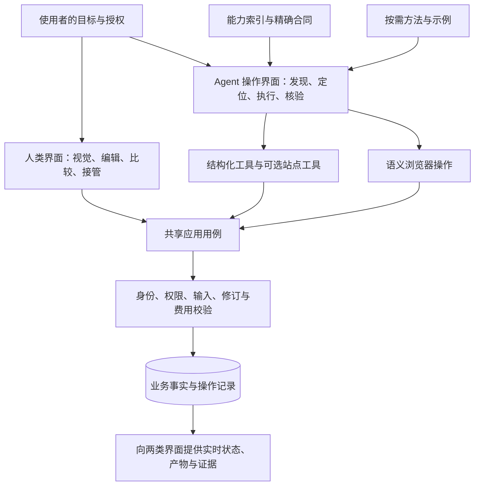
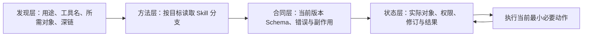

# 原则与架构

本页解释 AXI 的系统边界。规范要求集中在[版本化规范](specification/0.2.0/index.md)，跨 CLI、MCP、Skills、插件、MCP Apps 与原生宿主的分层见[协作模型](ecosystem/index.md)。

## 1. 两类界面，同一业务

人类界面和 Agent 操作界面必须表达同一资源、权限、修订、副作用和结果。Agent 的界面可以由 CLI、工具协议、站点工具与语义控件组合，不要求另画一套屏幕，也不要求每个按钮都有一个独立工具。

工具协议是接入方式，业务用例 Owner 是事实源，它可以运行在本地工作区或远程服务。浏览器显示的状态是投影，静态索引是路标，Skill 是方法，均不能越过最终授权或覆盖业务终态。页面、内容、执行和状态归属分开声明，设计及图表见[本地工作区与云端协作](practices/local-workspaces.md)。

分发目录负责取得可信组件；能力目录负责定位已启用动作。身份系统、包管理器和 UI 桥接保留各自合同，安装到退役的协作见[集成生命周期](lifecycle/index.md)。

## 2. 七项原则

| 原则 | 必须达到的行为 |
| --- | --- |
| 目标可发现 | 能从业务用途定位能力、所需上下文和入口；未知目标不要求遍历全站 |
| 对象可消歧 | 明确当前账号范围、资源、修订与所属区域；同名对象不自动选第一项 |
| 合同可执行 | 参数有精确结构，副作用和授权边界清楚，错误能指导下一步 |
| 状态可观察 | 明确装载、空、无权、失败、等待、部分完成和完成；不伪造进度 |
| 中断可恢复 | 未知结果沿原操作读取或重放，保留原输入、键和修订 |
| 上下文有边界 | 输入、输出、发现和等待有界；需要更多内容时可精确继续读取 |
| 结果可验证 | 核对实际产物、质量与成本；把失败、部分成功和未验证分开报告 |

速度优化应当减少无效发现、模型决策和重复等待。不能通过跳过授权、隐藏错误、损失必要字段或弱化质量核验来制造速度提升。

## 3. 四层信息架构

有明确上下文和已知合同可以直接进入执行，不必机械经过四次查询。层级用于分工，不是固定回合数。发现层应当小而稳定；状态层必须从当前范围读取，不能把上次会话的“当前项目”隐式当作事实。

## 4. 架构边界

- 优先复用业务用例；不让 Agent 接入层直接写数据库。
- 批量读取与等待放在确定性代码中；跨对象事务必须由业务明确提供。
- 不把任意 Shell、SQL、URL 或脚本执行器作为面向普通业务的通用捷径。
- GUI、工具和本机执行器可以共存；不叠加另一个推理 Agent 来替代可直接表达的操作。
- 客户端缓存必须限定账号、资源和修订；撤权、切换身份和资源变化时清除不适用内容。

## 5. 最小实施顺序

先覆盖真实高频任务：建用途索引、补对象语义、统一状态与恢复，再按证据添加批量和等待。只有定位或往返仍是已证实瓶颈时增加新的工具；工具数量少或多本身不是质量结论。
