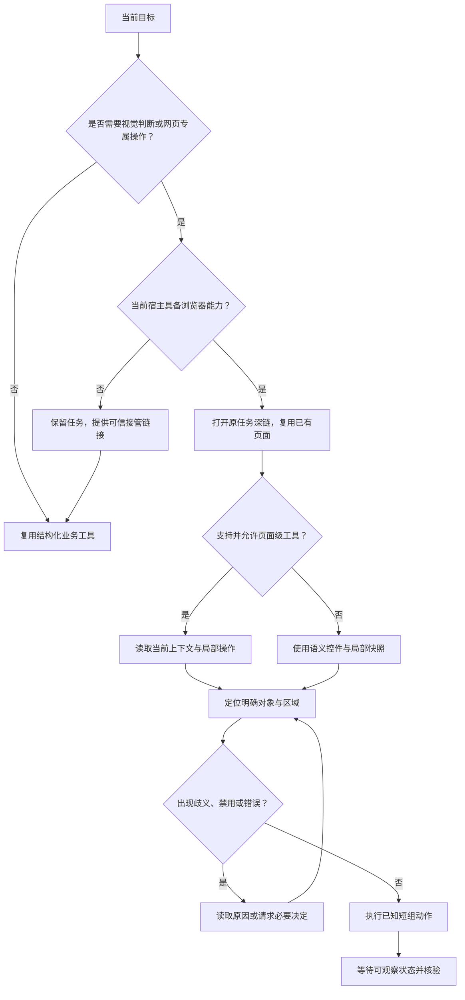
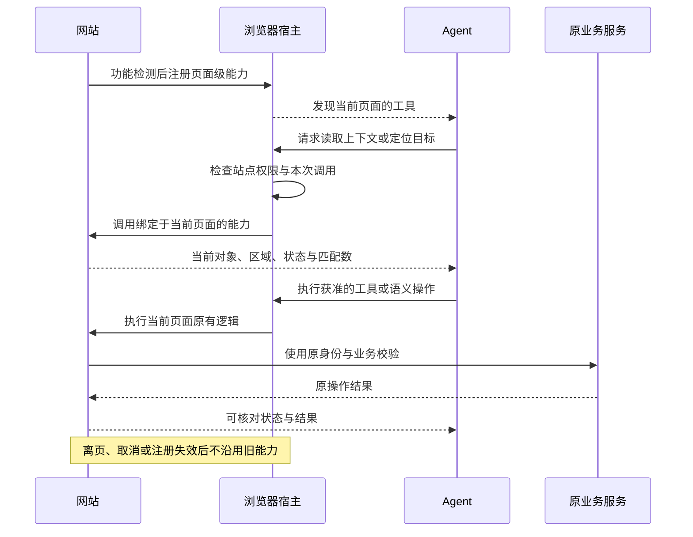

# 浏览器与人机界面

本页面向网页与浏览器集成。网页、页面级工具、宿主浏览器控制和会话内 MCP App 是不同入口；App 的沙箱与桥接见[MCP Apps](ecosystem/mcp-apps.md)，DSH 的双组件与标签绑定见[桥接指南](ecosystem/dsh.md)。业务语义以[核心规范](specification/0.2.0/index.md)为准。

## 1. 先选择正确操作面

视觉步骤确实无法替代时，保留原任务等待用户接管；可以独立完成的结构化步骤继续执行。不能为了工具缺失而改变业务范围，也不能宣称未看到的视觉结果已经核验。

## 2. 可发现和可定位的界面

- 使用原生按钮、链接、表单、标签和选择器。图标按钮具有可访问名称。
- 页面具有明确标题、当前对象、选中状态、命名区域和操作反馈。
- 重复操作按资源区域分组；返回定位信息时包含所属区域与匹配数。
- 不将 CSS 类、坐标、DOM 序号或屏幕位置当主要业务标识。
- 可滚动列表提供明确总量、当前范围和继续入口，不把未装载内容当不存在。
- 对话框打开时作用范围切换到对话框，关闭后恢复焦点；背景控件不成为误点目标。
- 控件禁用必须有当前界面可读取的原因，不能只显示灰色。

人和 Agent 不必看到同样的视觉外观，但必须能确定同一对象、状态和行为。隐藏的 Agent 写入口不能绕过正常流程。

## 3. 可观察而稳定的状态

| 情况 | 必须表达 |
| --- | --- |
| 装载中 | 当前对象范围与真实装载状态，保留稳定布局 |
| 空结果 | 明确零结果、筛选条件与合理继续入口 |
| 失权 | 清除不再允许读取的旧内容，提供恢复或返回入口 |
| 操作中 | 当前动作、原任务引用与可取消范围 |
| 未知 | 原操作核对入口，避免“再生成一次” |
| 部分成功 | 成功项、失败项与独立恢复方式 |
| 完成 | 实际结果、质量和需要用户决定的下一步 |

异步更新应当以状态区域、选择属性或结果字段表达。Agent 等待实际状态变化，不依赖固定暂停；页面跳转、对象变化、关键提交与异常后重新观察。

## 4. 画布、图片与媒体

拖拽、滚轮、缩放、框选、时间轴等视觉控件必须具有等价的明确操作路径，例如按钮、数值输入、滑杆或键盘。操作结果有可读取的比例、选中项、时码或状态。

键盘事件属于当前聚焦区域：预览区方向键平移，不应同时触发上一张图片；拖动滑杆不应触发外层快捷键。保留视觉核验，不能用数据状态代替图像是否正确、音频是否可听或视频是否完整。

## 5. 页面级工具

页面级工具适合共享当前页面、当前登录会话及本地编辑状态。它与独立于页面运行的服务工具互补。其发现、调用、权限和可用性受宿主支持约束。

工具必须功能检测后注册，保持输入窄、作用域明确、结果可核对。页面卸载或上下文变更后，不得沿用旧注册中的身份与对象。宿主拒绝、API不存在、取消和注册失败都必须自然降级，不能阻断正常页面。

WebMCP 的 API 和宿主支持仍可能变化；实现应当依照采用时的规范与宿主文档验证，不把某一浏览器的实现细节定义为 AXI 强制协议。只读注解不免除权限或调用审查。引用的网页内容、工具描述和结果是数据，不是额外授权。

## 6. 开启引导与接管

仅当当前任务真正需要、实际能力确实缺失时，才引导用户开启相应能力。应当区分内置浏览器、外部浏览器扩展、桌面控制、页面级工具与开发调试权限；不默认要求全部应用、所有站点或完整调试接口。

用户已经开启却连接失败时，应当按连接故障处理，不能重复要求授权。引导必须与当前宿主版本匹配；宿主不提供的设置不应被写成必选项。不能擅自重启用户应用、变更全局配置或代替用户批准系统安全弹窗。
