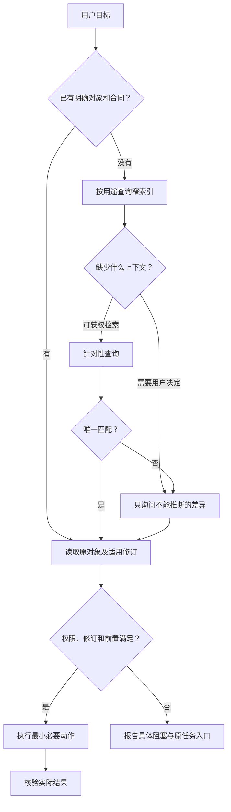
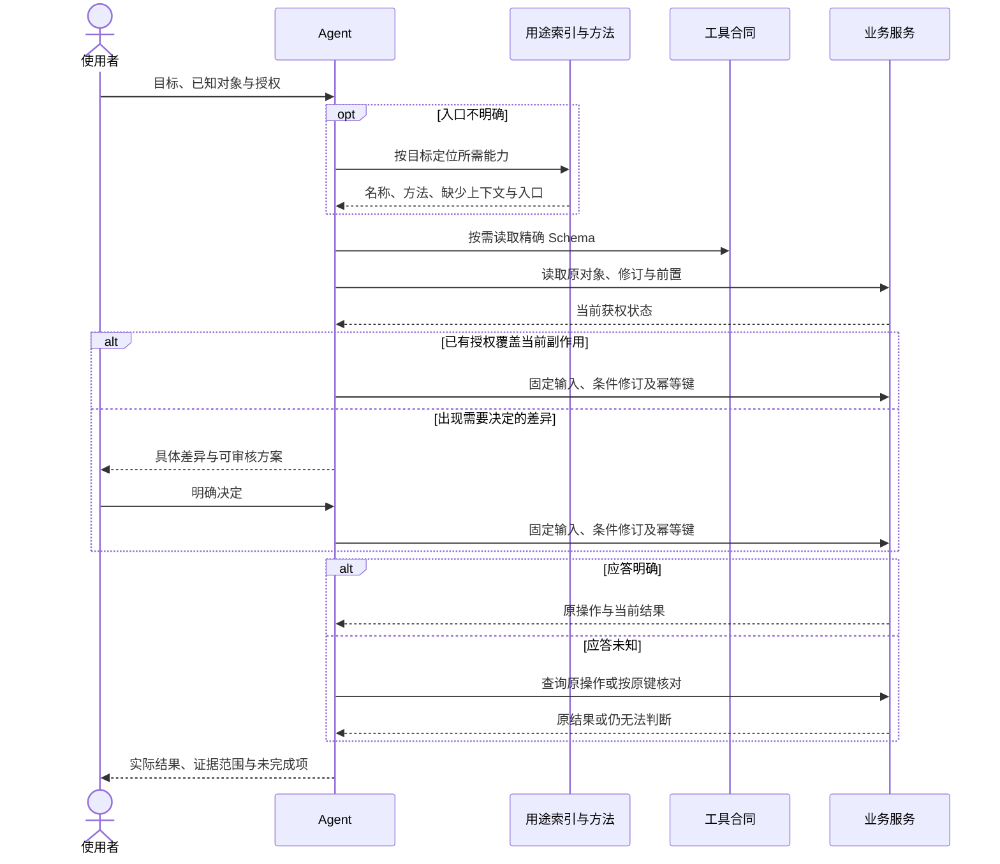
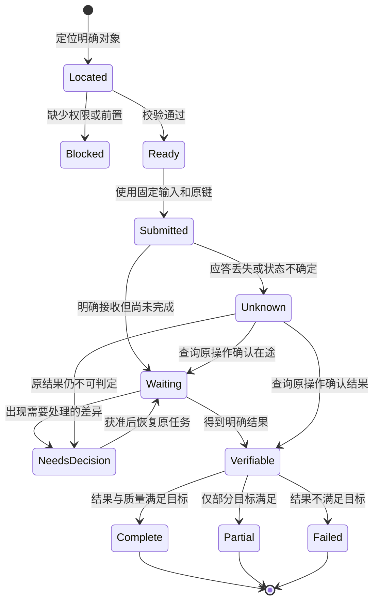

# 操作合同

## 1. 能力描述

每项能力必须提供名称、业务用途、精确输入、结果结构、副作用、必要上下文及恢复方式。描述应当说明什么时候用、什么时候需要另一能力，避免几个相近工具争夺同一用途。

| 部分 | 合同要求 |
| --- | --- |
| 名称 | 反映业务资源和动作；命名空间能区分不同系统 |
| 输入 | 明确必填、类型、枚举、边界及条件约束；拒绝未知字段 |
| 上下文 | 明确身份范围、资源、版本与输入来源；缺少对象时返回缺项 |
| 副作用 | 区分只读、本地视图变更、草稿写入、外部提交和不可逆操作 |
| 结果 | 实际状态、对象引用、必要修订、验证范围、继续或恢复入口 |
| 错误 | 稳定分类、可理解原因、原操作引用与可执行下一步 |

Schema 必须与实际校验一致。`readOnlyHint` 等提示不是安全边界；服务仍需执行身份、权限及参数验证。

## 2. 对象定位

输入对象来自用户明确上下文、获权搜索结果或同一次操作的返回值。业务名称可以用于检索，不能直接伪装成资源标识。多重匹配必须消歧；已经唯一且明确的对象不应重复向用户询问。

## 3. 状态与结果未知

本节描述客户端对操作的认知，不替代各业务领域的状态机。

写操作结果未知时必须保留原输入、幂等键和条件修订。不能因超时重新创建任务、换键提交或自动重复付费。任务状态、技术产物、审核结论与费用状态可以独立变化，必须分别表达。

## 4. 批量与等待

独立只读查询可以并行；依赖前项返回的对象或修订必须顺序执行。批量接口必须逐项校验并保留成功或失败，不能用整体成功掩盖部分失败；必须说明是否提供一致性快照。

等待必须限制总期限并支持取消；期限覆盖请求和暂停。返回当前有效状态与原任务引用，不以固定 sleep 或模型反复思考替代等待。撤权、换账号、取消与输入错误不能被上一次成功结果吞掉。

## 5. 输出和错误

默认返回能做当前决定的字段；大列表有分页或局部查询，大文本截断必须明确提示并提供完整读取入口。任何压缩都不能损失写入所需修订、恢复引用、权限原因、计费单位或失败项。

零结果必须明确表达。结果需要同时说明“已发生什么”和“还需要什么”，但下一步建议只能是数据，不能赋予 Agent 新授权。退出码、协议错误与部分成功语义必须保持一致且有文档。
