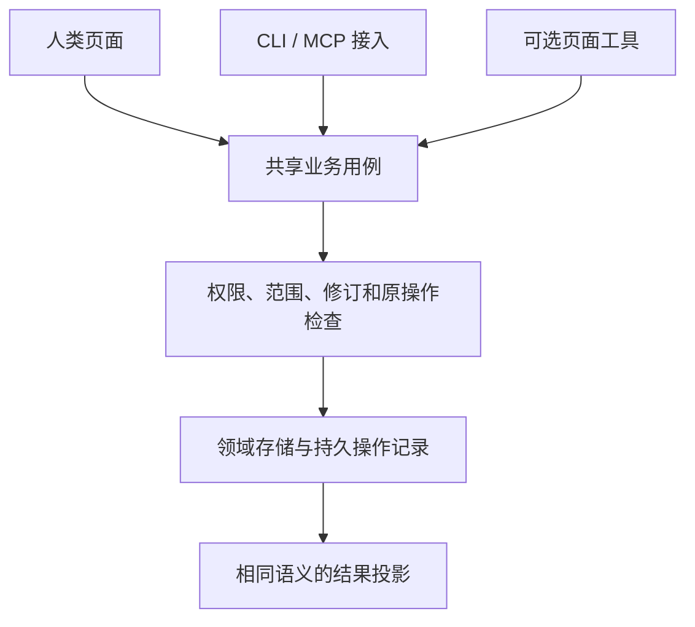

# 提供方指南

本指南面向把现有产品接入 Agent 的开发者。先完成一个真实任务的端到端合同，再复用到同类任务；不必把全部 HTTP 端点逐一包装成工具。

## 1. 定义任务边界

以“为指定文档记录审批决定”为例，写下目标对象、所需身份、可观察结果、需要用户决定的差异，以及失效后的恢复方式。读取文档与记录决定可以是不同动作，但应共享对象引用和修订。

| 问题 | 本例答案 | 生产实现要补充 |
| --- | --- | --- |
| 对谁操作 | 当前工作区的精确文档 | 实际范围授权与对象归属 |
| 成功是什么 | 审批决定已持久化 | 质量、审计和通知的独立结论 |
| 如何避免重复 | 范围化原键与固定输入 | 保留期、并发及下游幂等 |
| 失败怎样继续 | 读取差异或查询原操作 | 故障 SLA 与人工交接 |

## 2. 发布最小目录

目录只放用途、名称、副作用、必要上下文和精确合同引用。已知文档时走直接读取，不要求先列出团队、项目和所有文档。大量能力可以按领域或关键词窄查；小型目录可一次返回。

目录条目与动作合同由同一维护源产生，或通过引用检查保证一致。不要在 Skill、工具描述和网页帮助中手工重复完整参数定义。

## 3. 将业务用例作为唯一写入口

接入层只负责绑定参数、身份和输出格式。若新工具需要直接修改数据库才“更快”，先检查是否缺少正式业务用例，而不是把绕过路径固化为 Agent 专用接口。

## 4. 实现恢复后再开放提交

按[恢复规范](../specification/0.2.0/recovery.md)固定输入与键、定义保留期，并演练应答丢失、重启、并发和保留期过期。依赖外部服务时，确认其去重和回查能力，不能仅靠本地缓存承诺恰好一次。

首次预检可以提前解释缺项，正式写入重新校验。费用未知或超出预算时保留计划和原上下文，先取得适用决定。

## 5. 选择绑定与优化路径

优先复用已有 [CLI](cli.md) 或 [MCP](mcp.md) 接口；页面局部状态依赖浏览器时补[页面工具](../browser.md)。能力是否开放不取决于客户端有没有 Computer Use；结构化路径与普通界面应能独立工作。

先测定位失败、重复读取和等待，再决定是否加批量、长等待或缓存。新增操作必须有一个明确减少成本的任务证据，不能只增加工具数量。

## 发布前检查

完成[采用清单](../reference/adoption.md)，验证静态合同、负例行为和真实宿主任务。交付目录、合同、Skill、运行文件及摘要；发布后从目标渠道重新获取制品并验证新会话发现。源码测试通过不代表旧对话已加载新能力。
