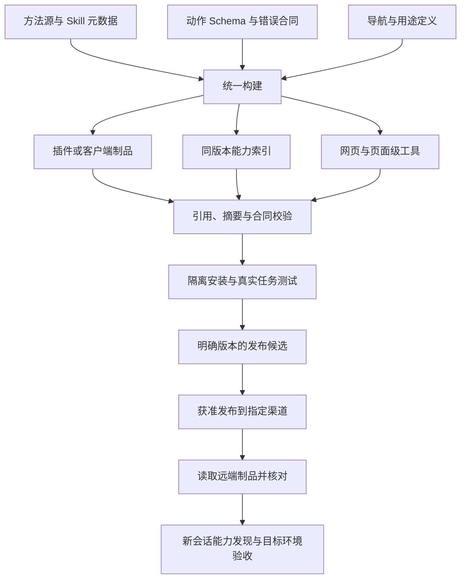

# 发现、Skills 与版本交付

本页说明组件如何一起交付。目录字段与失效要求以[能力发现规范](specification/0.2.1/discovery.md)为准，插件原生包和宿主边界见[插件与分发](ecosystem/plugins.md)。

## 方法、索引与实时合同

Skills 提供业务方法；索引告诉 Agent 方法和能力在哪里；工具 Schema 定义精确输入；实时读取证明当前对象和状态。四者应当分工，避免在多份文档手工复制完整参数合同。

| 载体 | 应包含 | 不应被用来证明 |
| --- | --- | --- |
| 能力索引 | 用途、名称、所需上下文、方法入口与深链模板 | 资源存在、本人权限、实时费用 |
| Skill 元数据 | 名称、简洁描述、适用条件 | 本轮已执行或已成功 |
| Skill 方法 | 选择路径、关键边界、恢复与核验方法 | 当前参数 Schema 永远不变 |
| 工具 Schema | 精确参数、类型和输入限制 | 当前业务前置已满足 |
| 实时上下文 | 当前身份范围、对象、修订、状态与可操作项 | 新权限或额外预算 |

## 渐进发现

宿主可用的插件说明应当提供简短的入口路标。目标已知时直接读取所需方法与 Schema；不要求每轮列出全部工具、技能、团队和项目。没有插件时，网站可以提供页面级工具；不支持时回到语义界面。

被动索引与主动 Skill 互补。常见入口的短索引适合常驻；详细工作流与长示例按需加载。不能把某项框架评测中索引胜出的结果，推广成所有 Skill 无用。

## 索引与版本

索引必须携带版本及合同标识。条目至少包含用途、支持的动作、所需上下文和方法入口；缺少对象时返回缺项，不能生成默认落到错误对象的链接。

网页导航与 Agent 发现应当从同一维护源生成，或由自动校验证明一致。索引不得包含凭据、私有用户数据、临时签名或不稳定部署快照。

若同时提供静态索引与运行时发现，必须说明二者的版本与权限边界。工具名或深链变化时同步更新索引和引用；返回旧索引时必须让调用者能识别其适用版本。

## 每次发版交付什么

每次发版交付本次声明支持的组件及其匹配关系：目录、Schema、运行文件，以及采用时的方法与 UI；纯 Skill 包不必捆绑实时服务，纯 CLI 也不必强制引入 Skill。没有变化的方法不必为了发版重写。采用清单绑定方法入口与支持资源的摘要，避免入口没改、引用方法却已漂移。

网页和插件可以不同步发布，但能力发现必须依据实际当前制品。新工具在源码存在不代表旧对话已经加载；升级后应当按宿主实际机制重新发现，不能手工覆盖运行缓存。

## 文档站的职责

文档站说明标准、方法和兼容边界；不承担业务授权或保存当前任务。文档索引、`llms.txt` 或 Markdown 内容协商有助于读取资料，但不能替代可执行 Schema、实时上下文和操作回执。

本站从同一导航生成 `llms.txt`、`docs.json` 与每页 Markdown，从规范编号生成 `requirements.json`，从 Schema 生成字段表。它们是阅读与实施索引，不是工具注册协议。方法示例见[Skills 方法层](ecosystem/skills.md)，安装到退役的协作见[生命周期](lifecycle/index.md)。

独立发布时，文档正文必须自包含。产品源码路径、发布域名、任务标识及上线记录放在产品采用清单，标准中只保留通用要求与独立示例。参考链接失效时，规范自身仍应可读、可执行和可验证。
