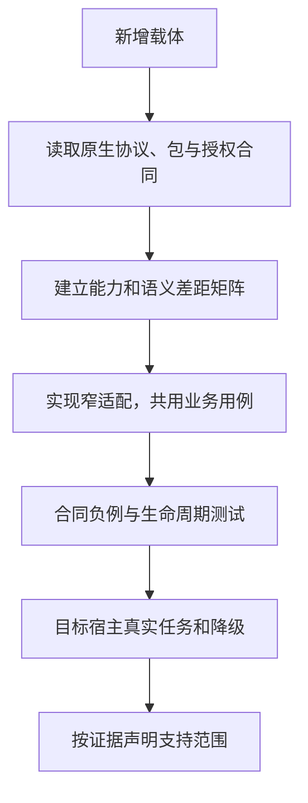

# 新载体适配

未来宿主、IDE 扩展、原生自动化或远程代理可以通过适配层加入。扩展的是到达同一业务能力的方式，不是另建一套资源、权限和任务状态。

## 最小适配合同

| 项目 | 必须回答的问题 |
| --- | --- |
| 身份 | 谁连接、令牌受众/范围是什么、怎样撤销 |
| 分发 | 原生包格式、可信来源、安装、启用与升级 |
| 发现 | 能力和方法从哪里来，如何窄查、缓存与失效 |
| 调用 | 输入如何映射，错误和取消如何保留 |
| 上下文 | 原对象、修订、页面状态与迟到响应如何隔离 |
| 观察 | 结果、部分失败、未知与等待如何表达 |
| 恢复 | 原操作如何跨连接与版本继续 |
| UI | 人如何检查、决定和接管；缺 UI 怎样降级 |
| 退出 | 禁用、撤权、卸载与退役各自影响什么 |
| 证据 | 哪些平台、版本和真实任务已测 |

## 适配过程

能用原生结构承载的语义直接映射；没有等价字段时，可以提供明确扩展或参考字段，但不能悄悄丢失 CAS、原操作或权限原因。AXI JSON 表示是可选互换格式，不要求每个宿主都包一层相同 JSON。

## 扩展与治理

原生适配不应先修改核心规范。只有跨载体可复现的问题确需共同字段或行为时，再按[提案流程](../community/contributing.md)演进核心。宿主专有信息放在显式命名空间，不新增永久的专用状态枚举污染所有实现。

新适配先标记文档或参考状态；通过目标宿主任务后才提升验证声明。不能把“理论上能接 MCP”写成“已支持”。
