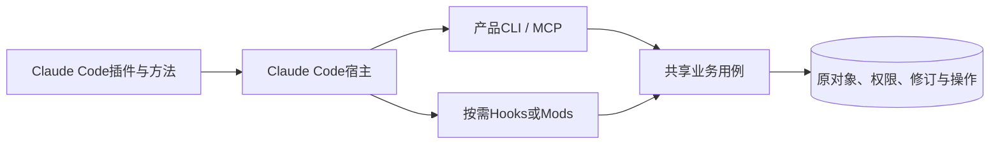

# Claude Code 适配

本目录独立记录Claude Code的原生扩展。2026-11-09已读取官方插件概览、组件、安装和Mods文档，来源见[参考资料](../../references.md#other-host-sources)。当前为文档调研，未安装插件或执行宿主互操作测试。

## 已确认的接口面

| 能力 | 官方文档确认的方向 | AXI映射 |
| --- | --- | --- |
| 插件 | `.claude-plugin/plugin.json`与marketplace | 发行者、版本、来源、安装范围和启用独立记录 |
| Skills / commands | 按组件加载方法和命名空间调用 | 目标触发、精确定位、执行与恢复方法 |
| Agents | 插件可交付子Agent定义 | 委托仍保留任务、范围与结果来源 |
| Hooks | 生命周期处理器 | 有界检查，不代替业务必须执行的授权 |
| MCP | 插件组件可配置服务 | 复用工具/资源合同及原操作 |
| Mods | JavaScript hooks模块，可增加面板和命令 | 原生会话交互扩展，不能当成MCP Apps同义词 |
| 其他组件 | 当前组件文档还列LSP、可执行文件、设置、主题、channels和monitors | 按产品实际需要选择，不默认全部安装 |

Claude Code插件与Claude网页/Cowork插件、IDE扩展是不同产品面，不能因组件名称相同就宣称相同运行范围。Codex兼容导入或同用SKILL.md不保证hooks、Mods、插件清单或UI协议兼容。

## 接入结构

默认由CLI/MCP完成核心流程，再根据真实需求选择原生面板和浏览器接管。不能在本目录规定`document.oai.annotation`或`window.openai`为Claude接口，也不凭MCP支持推断WebMCP或MCP Apps可用。

## 生命周期与验证范围

采用方需要分别验证marketplace、安装scope、当前会话加载、组件清单、更新、禁用和卸载。Mods能到达的本地资源与信任范围要独立审查，不把它当普通无副作用的方法文字。

本轮没有冻结Claude Code运行时版本或完成Mods、浏览器、原生选择和文件编辑的运行证据。进一步实现按[新载体合同](../adapters.md)与[通用验证](../../verification.md)补齐，不能复用Codex测试结论作为通过。
