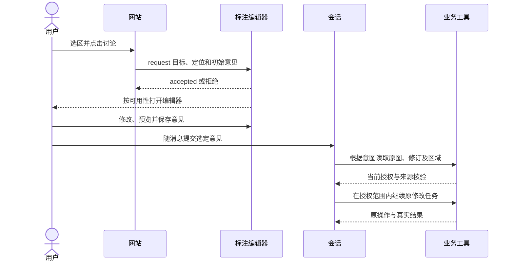

# Browser Annotation API

标注扩展让用户从网页选中对象、文字或画布区域，补充意见与参数提议，再随消息带入对话。它补充[WebMCP动作](webmcp.md)，不负责替用户发送消息或执行模型修改。官方来源见[参考资料](../../references.md#codex-sources)。

## 支持条件

官方指南面向 DevDay 2026 发布及之后的桌面应用，入口为 `document.oai.annotation`。在启用时，API于页面脚本执行前注入安全顶层文档，例如HTTPS或localhost。DOM元素存在后初始化，逐方法功能检测，不需要轮询或等待自造的ready事件。

企业与教育工作区还受 Site annotation customizations 策略控制。普通网页标注不要求网站改代码；定制能力受站点权限和方法支持约束。画布surface不支持iframe或shadow DOM中的host，不能从WebMCP的frame支持推导标注也支持。

## 接口总表

| 接口 | 用途 | 结果与边界 |
| --- | --- | --- |
| `oai-annotation-container` / `oai-annotatable` | 将DOM区域作为可选对象 | 单独放 `oai-annotatable` 不改变选择规则 |
| `oai-annotation-container-text` | 标注模式中拖选文字 | 与元素容器同处时文字选择优先 |
| `oai-annotation-metadata` | 携带少量业务定位 | 用户与模型都能看到，不是隐藏数据 |
| `request(target, options)` | 从用户点击打开标注请求 | 同步 `{accepted}`，不证明打开、保存或发送 |
| `registerControls(options)` | 注册颜色、范围、枚举、开关 | 返回可 `update()` / `dispose()` 的句柄 |
| `registerSurface(options)` | 画布内稳定对象命中与反馈 | 返回可 `invalidate()` / `dispose()` 的句柄 |
| `toggle(active?)` | 请求进入、退出或切换模式 | 同步 `{accepted}`，从实时用户交互调用 |
| `isActive()` | 读取已确认模式 | 不需要用户手势 |
| `oaiannotationcontrolchange` | 预览、原始对比和重置 | 可逆临时呈现，不是永久保存 |
| `oaiannotationmodechange` | 已确认模式变化 | `detail.active`；无初始事件或强制无变化的重复事件 |

注册方法同步返回，`hitTest`可以异步。无方法、异常和拒绝都不得破坏产品原有编辑器。

## 选区与定位元数据

```html
<section oai-annotation-container>
  <figure
    id="review-image"
    oai-annotatable="当前候选图片"
    oai-annotation-metadata='{"resource":"image-42","revision":"7","region":"coat"}'
  >
    
  </figure>
</section>
```

DOM元数据是小型扁平JSON：最多6个属性；值为字符串、有限数、布尔或null；key最长64字符，字符串值最长256字符，序列化最多2048字节。key以ASCII字母开头，只用字母、数字、单空格、下划线或连字符，不支持嵌套对象和数组。无效元数据会被忽略。

图片区域用原始图坐标或归一化坐标保存到业务文件；元数据带精确来源与区域引用。屏幕像素用于当前高亮，不能作为长期区域事实。完整坐标与意见可从获权文件或工具读取，不将大文档塞进元数据。

## 从产品按钮打开标注

以下片段放在已存在的 `review-image`、`discuss-image`按钮与`annotation-status`状态元素之后。回退可以继续使用应用原有的意见文件或复制入口。

```javascript
const target = document.getElementById("review-image");
const button = document.getElementById("discuss-image");
const status = document.getElementById("annotation-status");

button.hidden = typeof document.oai?.annotation?.request !== "function";
button.addEventListener("click", () => {
  const annotation = document.oai?.annotation;
  if (typeof annotation?.request !== "function") return;
  try {
    const result = annotation.request(target, {
      initialComment: "仅调整已标区域，其余内容保持不变。",
      metadata: { resource: "image-42", revision: "7", region: "coat" },
    });
    status.textContent = result.accepted
      ? "已请求打开标注"
      : "未接受请求，请使用页面意见入口";
  } catch {
    status.textContent = "无法打开标注，请使用页面意见入口";
  }
});
```

`request()`必须直接位于当前用户交互中；先等待网络保存可能丢失手势。需要先保存时，分成“保存”与之后的显式打开动作，不制造“已发送”回执。

| options字段 | 行为 |
| --- | --- |
| `initialComment` | 可编辑意见，最多240个UTF-16 code units |
| `mode` | `default` 或 `advanced`；文字Range仅支持default |
| `enterAnnotationMode` | 进入模式，取消或发送后保持该模式 |
| `omitScreenshot` | 请求省略自动截图，默认false |
| `metadata` | 对普通元素，以有效非空对象替代HTML元数据；文字Range和shadow DOM内部元素忽略 |

目标可以是当前文档中已连接、位于可见区域的HTML元素或有效DOM Range，不能直接传虚拟画布对象ID。文字Range需非空、非纯空白、可见且至少部分在视口，最多20000个UTF-16 code units。调用后保持目标可用，宿主打开编辑器前还会重验。

## 保存、输入框与发送的区别



浏览器API没有提供网站可依赖的“用户已发送”回调。业务可记录自己的保存状态，但不能从 `accepted`、退出模式或关闭弹层推断用户提交。退出模式会保留已保存标注，不会自动提交或移动到输入框。

普通网站不读取或改写宿主输入框。MCP App可协商消息和上下文桥接，自有客户端可使用App Server；这两条路径各有自己的授权和发送行为，见[原生界面](interfaces.md)与[运行时](runtime.md)。

## 可逆的自定义控件

`registerControls()`接收 `targets`、`controlsHeading`、`controlsMode` 和 `controls`。`controlsMode: "replace"`可替换内置控件；各类型必须使用明确属性名，例如“线宽”，不能随当前值把标签变成“细线”。

| 类型 | 值 | 附加字段 |
| --- | --- | --- |
| `color` | 3、4、6或8位十六进制颜色 | 无 |
| `range` | 有限数 | `min`、`max`、`step` |
| `select` | 字符串 | `options: [{label, value}]` |
| `toggle` | 布尔 | 无 |

每个控件有 `label` 和唯一的字符串 `callback`，callback不是函数。`reference`可指向业务属性或token。`currentValue`表示普通草稿的真实基线，`defaultValue`是建议起始值并优先于它；基线不能取自临时预览或未完成输入。

```javascript
const annotation = document.oai?.annotation;
let registration;
if (typeof annotation?.registerControls === "function") {
  registration = annotation.registerControls({
    targets: target,
    controlsHeading: "区域修改",
    controlsMode: "replace",
    controls: [{
      type: "select",
      label: "修改范围",
      callback: "editScope",
      options: [
        { label: "仅已标区域", value: "region" },
        { label: "整张图片", value: "image" },
      ],
      defaultValue: "region",
    }],
  });
}
// 卸载组件时调用；有预览的集成还需恢复普通呈现和移除监听。
function cleanupControls() {
  registration?.dispose();
}
```

此例仅收集选择，没有直接预览或业务保存。省略 `currentValue` 时，即使用户保留初始选择也会把选项带入标注；select发送给模型的是可见label，不是内部value。重要定位ID另外通过元数据或业务引用保存。

`oaiannotationcontrolchange.detail`携带`callback`、`value`、`action`。`preview`、`preview-original`和`reset`都应用事件给出的值，处理器需可重复、可恢复。普通草稿、建议值和预览分开保存；永久保存继续走产品原流程。

关键限制：每注册最多12控件、1到128个目标；label、heading、callback最长80个UTF-16 code units；select为1到12选项；文档最多64注册和1024个目标关联；控件序列化上限16384个UTF-16 code units。range有限值在-10000到10000之间，`min < max`，step在0.001到10000且不大于范围。注册和更新可同步抛错，拒绝更新保留旧注册。

`registration.update()`只影响未来标注。已有标注保持捕获目标和基线；DOM替换后不会把旧事件重定向到新节点。`dispose()`不自动回滚应用的临时预览，移除旧节点后也可能收到对旧目标的reset，应保留正确清理路径。

## 画布对象

`registerSurface({element, hitTest, renderSelection?})`用于canvas等非DOM对象。hitTest接收`clientX`、`clientY`和`signal`，返回稳定`id`或明确的`null`；还可返回`name`、`role`、`metadata`和`rect`。

`rect`是可见视口的CSS像素坐标，需要转换场景缩放和平移。ID在surface内稳定，不能随排序和缩放变化。`renderSelection`收到`hoveredId`和`selectedId`，用来绘制应用自己的高亮。

hitTest应读取本地索引，不发模型或业务网络。宿主允许250ms后降级DOM选择；错误与无效结果也降级。异步命中一次只允许一个在途槽位，取消后promise仍需resolve或reject，不能丢弃worker回复导致后续永远无法选择。

缩放、移动与对象变化后调用`surface.invalidate()`，卸载时`surface.dispose()`。虚拟对象自定义控件事件包含`detail.virtualTarget: {surfaceId, targetId}`，必须路由到捕获对象，不能使用之后的新选区替代它。

## 模式、隐私与降级

模式按钮在用户点击中调用`toggle()`，通过`isActive()`和`oaiannotationmodechange`显示真实状态。相同布尔值请求幂等；`accepted`不证明状态改变。标注模式会捕获页面点击，按住Space可临时操作页面；不存在可依赖的`oai-annotation-ignore`穿透属性。

只有确需更深入控件才设置`mode: "advanced"`或页面meta默认。用户取消、权限撤销、API缺失、宿主占用与旧版本都应回到普通编辑器。截图和元数据仅含当前任务获准内容；省略截图不意味着元数据没有隐私风险。

验收须覆盖保存后重开、清除预览、切换对象、移除DOM、模式撤权、异步取消和无API浏览器。详见[验证矩阵](verification.md)。
