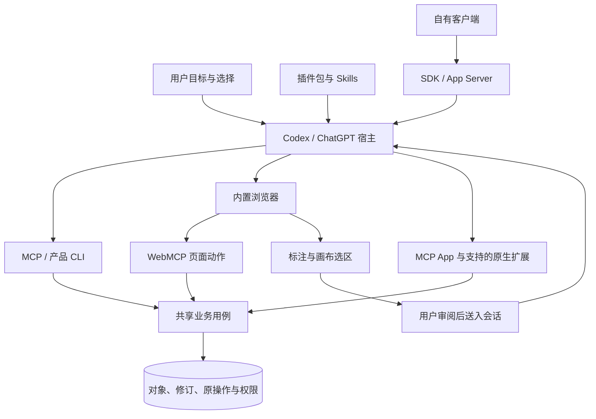
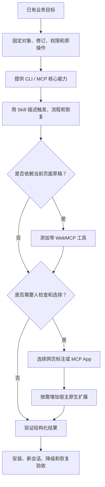

# Codex 开放接口

本组文档说明如何把产品接入 Codex，并与 ChatGPT 共享可用的插件组件。范围包括工具、页面、画布、文件、会话及安装生命周期。接口事实核对于 2026-11-09，来源集中在[参考资料](../../references.md#codex-sources)。这是 AXI 的宿主适配指南，不改变 0.2.1 核心协议。

## 从任务选择入口

| 任务 | 入口 | 继续阅读 |
| --- | --- | --- |
| 按方法组合已有能力 | Skills，可随插件交付 | [插件与连接](plugins.md) |
| 不依赖打开页面的检索、保存、生成与恢复 | 本地或远程 MCP，产品 CLI | [插件与连接](plugins.md)、[运行时](runtime.md) |
| 操作用户正在编辑的网页、筛选或画布 | Site tools / WebMCP | [页面工具](webmcp.md) |
| 把用户选择、圈点、评论和参数提议带到对话 | Browser Annotation API | [标注扩展](annotations.md) |
| 在会话中检查、比较、编辑与选择 | MCP Apps，按需增强 OpenAI 扩展 | [原生界面与文件](interfaces.md) |
| 侧栏入口、会话面板、文件编辑器、输入框引用 | OpenAI MCP Extensions | [原生界面与文件](interfaces.md) |
| 原生表单、图片选择或登录接续 | MCP elicitation，按宿主协商增强表单 | [原生界面与文件](interfaces.md) |
| 编程启动和恢复 Codex 工作 | SDK / App Server / `codex exec` | [运行时](runtime.md) |
| 生命周期检查、事件订阅 | Hooks / MCP Events，分别核对支持范围 | [运行时](runtime.md) |
| 需要页面渲染、拖拽或最终视觉核验 | 宿主浏览器控制；按需人工接管 | [页面工具](webmcp.md) |

产品只接入目标所需的能力。安装插件不是网页工具、标注扩展或 SDK 的共同前置条件。

## 架构

图中的箭头表示集成职责，不是新增 AXI 消息。网页用自己的页面身份，MCP 用自己的连接身份；它们必须在业务层验证是否指向同一账号、项目与对象。

## 三种执行环境

| 环境 | 开放接口 | 身份与有效期 | 不可推导 |
| --- | --- | --- | --- |
| 安全网页文档 | `document.modelContext`、`document.oai.annotation` | 当前文档、站点权限和页面会话 | 不能访问宿主输入框 DOM 或任意会话 |
| MCP App 沙箱 | MCP Apps `ui/*` 桥接，按能力使用 `window.openai` | 宿主授予的能力、工具连接和视图实例 | 不能直接复用父页面 Cookie 或磁盘权限 |
| 本地执行器 / 自有客户端 | 产品 CLI、MCP stdio、Codex SDK、App Server | 进程环境、目录范围、连接和会话 | 不自带桌面浏览器、原生面板或标注 API |

`document.oai.annotation.request()`、MCP Apps `ui/message`、App Server `turn/start` 分别属于这三种环境。它们的发送语义、权限和生命周期不同，不能封装成一个无条件“发送到 Codex”的函数。

## 宿主支持矩阵

“可用”仍受精确版本、模型、账号、策略和权限约束。下表是官方文档确认的范围，不代表本仓库完成宿主互操作测试。

| 能力 | 桌面应用中的 Codex | Codex CLI | IDE 扩展 / 云端 |
| --- | --- | --- | --- |
| Skills 与 MCP | 支持相应本地与远程配置 | 支持相应本地与远程配置 | 按各自环境配置，不继承本机文件与连接 |
| 插件发现与安装 | 支持插件目录 | `/plugins` 和插件命令 | 官方说明 IDE 不支持插件；云端按产品表面另验 |
| 内置浏览器控制 | 按浏览器和站点权限提供 | 不能假设存在 | 不能从桌面能力推导 |
| Site tools / WebMCP | 官方限定桌面内置浏览器，需支持模型 | 无等价内置页面面 | 云端网页浏览器不能据此宣称支持 |
| Browser Annotation API | 受支持的内置浏览器页面，逐方法检测 | 不提供网页注入环境 | 普通外部浏览器和 iframe 不按桌面顶层支持推导 |
| MCP Apps | 按连接和宿主 UI 能力实测 | 保留结构化工具路径 | 逐表面测试，不把 MCP 支持当作 UI 支持 |
| OpenAI MCP Extensions | 文档主要描述 ChatGPT 界面；逐项验证 Codex | 不推导原生面板或输入框扩展 | Composer mentions 仅桌面；其余按扩展文档核对 |
| Hooks | 本地运行及信任策略约束 | 本地运行及信任策略约束 | 云编排只支持特定管理员 MCP hooks，非插件 hooks 通用运行 |

Desktop only 是公共目录的分发标记；CLI marketplace 又是独立渠道。不能从某个私有 stdio 包在 CLI 可运行，推导同一个公共目录制品可在 CLI 或云端安装。

## 接入次序

纯本地任务直接使用已知项目或产品公布的默认目录。只有遇到当前任务需要的远程模型、存储或团队能力时，才接续连接和选择；不先让用户学习运行拓扑。

## 公开接口与宿主工具

官方文档中的网页 API、MCP 合同、SDK 和 App Server 可以成为采用方的实现依据。当前 Agent 会话里出现的 `open_in_codex`、`request_user_input_async`、浏览器 REPL、工作树、通知或任务工具，是宿主向该会话提供的工具；其名称和签名不构成第三方插件可调用的通用 API。

第三方插件不能在 Skill 中写下这些名称，就保证工具出现。需要用户输入时用协商过的 elicitation；需要页面操作时用 WebMCP；需要自有客户端时用 App Server。缺少能力时保留 CLI、结构化结果或可信接管路径。

## 证据与版本

采用方记录桌面/CLI/SDK版本、OS、账号方式、插件来源与版本、服务合同、UI资源摘要、模型、权限和验证日期。官方可发现、实际可调用、业务成功和视觉正确分别验收，见[验证矩阵](verification.md)。

其他宿主使用各自的原生机制，分别维护[Claude Code](../claude-code/index.md)、[WorkBuddy](../workbuddy/index.md)和[DSH](../dsh/index.md)目录。不能把Codex的接口名写入它们的实现合同。
