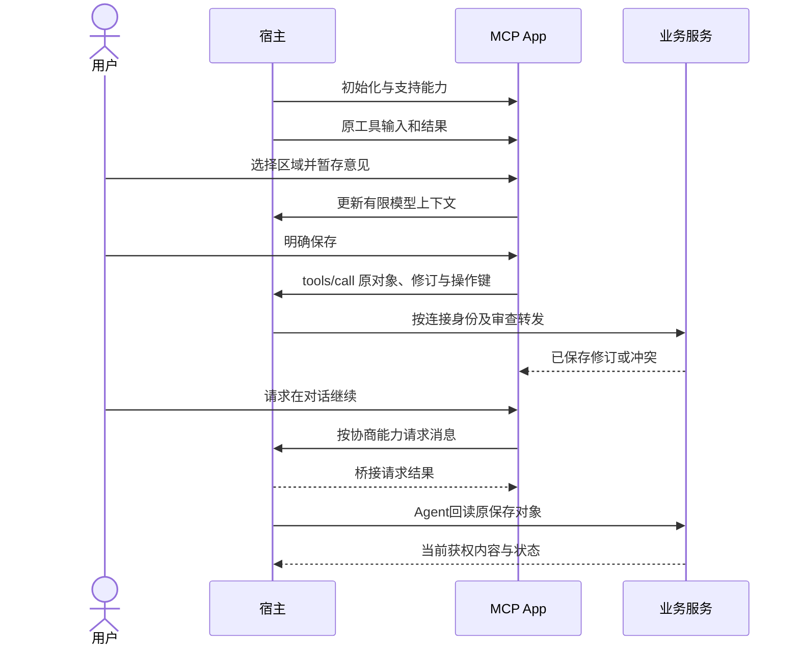

# 原生界面、文件与会话

MCP Apps 是可移植的交互基础，OpenAI MCP Extensions 在支持的宿主中补充原生入口、文件、选择和会话协作。普通网站的WebMCP与标注API是另一执行环境。接口来源见[参考资料](../../references.md#codex-sources)。

## 标准桥接优先

| 目的 | MCP Apps | ChatGPT兼容别名或扩展 |
| --- | --- | --- |
| 绑定工具与UI | `_meta.ui.resourceUri` | `openai/outputTemplate`兼容别名 |
| 输入与初始化 | `ui/initialize`、`ui/notifications/tool-input` | `window.openai.toolInput` |
| 结果更新 | `ui/notifications/tool-result` | `window.openai.toolOutput` |
| UI调用工具 | `tools/call` | `window.openai.callTool` |
| 发出后续消息请求 | `ui/message` | `window.openai.sendFollowUpMessage` |
| 更新模型可见上下文 | `ui/update-model-context` | 按扩展增强附件和显示 |

UI使用SDK完成握手、能力协商和消息校验，不把任意`postMessage`当可信宿主输入。新实现优先中间列，专有能力逐项检测，不能根据userAgent字符串猜支持情况。

需要批准的工具，初始`toolInput`可以为空。宿主在批准后通过tool-input通知交付，UI不能以空值自行调用默认写操作。

## OpenAI 原生扩展目录

以下11类已列入官方扩展概览。该页主要描述ChatGPT界面，不据此宣称每类均可用于Codex、CLI、所有计划或云端表面。采用方冻结SDK与宿主版本后逐项实测；正文未列出的底层扩展字段不应由名称猜造。

| 扩展 | 产品用途 | AXI接入要求与降级 |
| --- | --- | --- |
| Sidebar apps | 全局侧栏打开应用 | 保留当前账号、项目与深链；无入口时由工具返回视图 |
| Conversation panels | 与会话并排工作 | 绑定原会话与任务，切会话不混入另一上下文 |
| Plugin settings | 宿主内设置产品参数 | 区分产品偏好、连接和模型密钥；无原生设置时使用产品设置页 |
| File viewers and editors | 按扩展名打开文件、更新与保存 | 绑定宿主资源URI、修订与文件权限；保留原文件格式 |
| Display modes | inline、fullscreen、PiP等呈现 | 协商可用模式，适配宿主尺寸；拒绝时保持当前可用视图 |
| Deep links | 进入应用内指定对象 | 链接不授予权限，打开后重验对象、身份与修订 |
| Extended model context | 选区、附件与输入框上下文 | 传精确引用和有限摘要，不导出整个项目或凭据 |
| Extended message sending | 发送到当前或新会话 | 以用户意图和已协商目标为准，防止重复发送和自激循环 |
| Composer mentions | 输入框内检索并引用内容 | 官方限定桌面；引用时固定版本并重验权限，无支持时返回可读引用 |
| Extended forms | 结构化输入和图片选项 | 能力协商，处理accept/decline/cancel；不以超时当批准 |
| Plugin onboarding | 安装后接续setup方法 | 当前任务所需时渐进连接，无远程需求先完成本地目标 |

原生面板、文件编辑器和输入框引用属于插件产品集成，不要求把网页编辑器搬进一个小卡片。标准MCP Apps和宿主专有扩展必须分别记录支持范围。

## 工具与原生入口元数据

以下为注册MCP App工具时的`_meta`片段；实际工具仍需Schema、权限和正式执行器。

```typescript
const panelMetadata = {
  ui: { resourceUri: "ui://review/workspace" },
  "openai/ui": {
    entrypoints: [{ type: "thread" }],
  },
};

const fileMetadata = {
  ui: { resourceUri: "ui://review/markdown-viewer" },
  "openai/ui": {
    entrypoints: [{ type: "file", extensions: ["md"] }],
  },
};
```

`type: "global"`表示侧栏入口，`thread`表示会话面板，`file`表示文件处理入口。`extensions`匹配扩展名，不赋予磁盘遍历能力。文件App收到的是资源URI，不应把它当宿主本地绝对路径。

UI资源内容使用`text/html;profile=mcp-app`。工具描述的`_meta.ui.visibility`可限定`model`、`app`或两者；这只是发现/调用面，不替代服务端授权。资源的`_meta["openai/ui"].availableDisplayModes`可在载入前声明支持模式，仍需初始化协商。

## 状态、上下文与持久化



业务内容和跨会话状态存于正式文件或服务。`widgetState` / `setWidgetState()`可保存视图实例状态，但不能充当多人业务数据库、CAS或任务恢复日志。设置值不能混入密钥。

`content`与`structuredContent`对模型可见；结果`_meta`仅交付组件，但仍应只含组件获权的最少数据，不是安全凭据库。`toolResponseMetadata`用于保留完整工具回执，不用纯UI成功状态覆盖服务端未知状态。

上下文更新不会自动执行修改；消息桥接请求也不证明业务已完成。视图关闭或新消息发出后，Agent按原对象、修订与操作回读。引用内容中的指令不扩大用户授权。

## 文件桥接

| 公开组件方法 | 用途 | 限制 |
| --- | --- | --- |
| `window.openai.uploadFile(file, {library?})` | 上传用户选定文件，返回fileId | 可选library受账号能力限制；上传是明确的数据传输 |
| `window.openai.selectFiles()` | 选择宿主文件库中的文件 | 功能检测；不能据此读取任意本机文件 |
| `window.openai.getFileDownloadUrl({fileId})` | 获得临时下载地址 | 仅限插件获权的文件引用，地址不长期持久化 |

工具的`_meta["openai/fileParams"]`可声明文件输入字段。输入是含`download_url`与`file_id`的文件对象，而不是应用可随意拼装的宿主路径。下载后校验类型、大小、摘要和实际解码，失败保留原引用。

内置浏览器的通用自动化上传限制与MCP App的显式文件选择/上传桥接是不同能力。不要因组件有uploadFile，就宣称Agent可自动操作浏览器任意上传框。

本地优先产品默认使用本地文件；上传或转存到宿主文件库在实际需要时明确触发。保存编辑时遵守原文件或领域的修订合同，不能用临时下载URL作为版本ID。

## 组件窗口与外链

`requestDisplayMode()`、`requestModal({params, template})`、`requestClose()`、`notifyIntrinsicHeight()`、`openExternal({href, redirectUrl})`和`setOpenInAppUrl({href})`是官方列出的可选组件桥接。它们只在提供它们的组件环境使用，普通网页不能假设存在。

模态窗口用于聚焦的选择与编辑，关闭后恢复焦点。全屏与PiP不是多个独立业务任务。高度通知用于避免裁剪，不在每帧反馈中制造无限resize循环。

外链、资源、连接和嵌套frame分别按CSP声明：`_meta.ui.csp`使用`connectDomains`、`resourceDomains`和可选`frameDomains`。ChatGPT的`openExternal`跳转允许列表仍使用兼容`openai/widgetCSP.redirect_domains`，不能误以为标准CSP已包含它。

## 原生选择与权限请求

MCP elicitation区分form与URL请求；OpenAI增强表单还可带图片选项。原生选择适用于用户本来要做的决定，例如输出目录、候选或当前缺少的模型连接，不重复询问已确定上下文。

增强表单的选项使用`const`、`title`及可选`x-openai-thumbnail`。OpenAI已注册MCP服务按当前指南需要MRTR支持；不能只返回一段JSON就宣称弹出了宿主图片选择框。协议能力与输入范围先协商，拒绝和取消有独立结果。

不要在普通表单里收集密码或私钥。登录使用对应URL/OAuth流程；任一native form都不免除业务最终授权。无表单支持时，TTY交互或现有网页接管继续同一个任务，非TTY返回结构化缺口。

## 验收边界

记录每项扩展的宿主、模式、连接与SDK制品。测试初始化失败、缺输入、无扩展、外链拒绝、文件撤权、并发保存、上下文切换、重挂载及消息重复。没有在目标宿主运行过的能力标为文档适配，见[验证矩阵](verification.md)。
