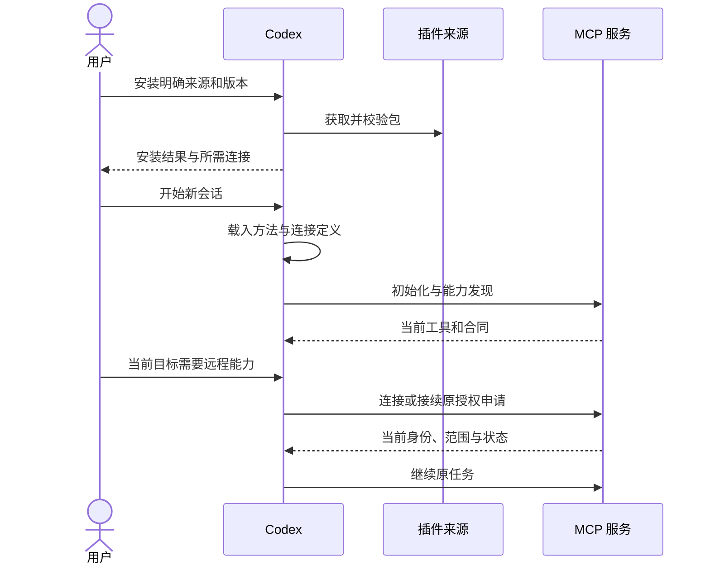

# 插件、Skills 与连接

插件负责交付方法和连接定义，MCP 提供动态能力，业务服务执行最终授权。本页面向 Codex 适配；通用职责见[插件与分发](../plugins.md)。官方依据见[参考资料](../../references.md#codex-sources)。

## 包结构与扩展位置

```text
package/
├── plugin.json
├── mcp.json
├── skills/
│   ├── setup/SKILL.md
│   └── document-review/
│       ├── SKILL.md
│       └── agents/openai.yaml
├── assets/
└── hooks/hooks.json
```

根 `plugin.json` 是 Agent Plugins 可移植入口。`skills/` 和 `mcp.json` 是固定的可移植组件位置。hooks 是按需组件，公共目录限制见下文。

| 位置 | 内容 | 边界 |
| --- | --- | --- |
| 根 `plugin.json` | 名称、版本、说明、发行者等身份元数据 | 不放连接凭据 |
| `extensions.com.openai` | 展示、注册服务映射、onboarding、hooks 等 OpenAI 设置 | 不作为 AXI 网络合同 |
| `.codex-plugin/plugin.json` | OpenAI 兼容清单 | 有内联 `extensions.com.openai` 对象时，整个 overlay 被替代，两者不合并 |
| 根 `mcp.json` | `mcpServers` 及 transport | 不能只重命名旧 `.mcp.json`，需要校验字段和 transport |
| `.app.json` | 已注册 MCP 服务的映射 | 不是任意远程网页或 MCP App HTML |
| `agents/openai.yaml` | 单个 Skill 的界面、触发策略与工具依赖 | 依赖声明不证明已经安装、连接或授权 |

扩展路径相对插件根并以 `./` 开始，不能逃出包根。可写项目、操作记录和凭据不存回安装缓存。hooks 如需运行数据，使用宿主提供的可写位置；不要修改只读包以保存状态。

## Skills 的最小职责

Skill 的 `name` 和 `description` 负责匹配目标，正文负责方法，references 和脚本按需载入。避免每轮完整注入合同和工具大全。

方法至少说明：

1. 何时使用，哪些相似目标不适用。
2. 已知项目、对象和原操作如何直接继续。
3. 未知能力如何窄查，再读精确 Schema。
4. 如何处理缺权限、冲突、未知结果、取消和部分成功。
5. 哪些步骤需视觉检查，哪些能在无浏览器环境完成。
6. 最终应交付的真实文件、结果、证据和未完成项。

`policy.allow_implicit_invocation: false` 可限制隐式调用，显式 Skill 调用仍可用。不能用方法说明代替服务端授权，也不能在 Skill 中保存 API Key、完整动态权限清单或运行中的任务快照。

## 安装与新会话



Codex CLI 可用 `/plugins` 浏览，安装后开始新会话再验证方法和工具。自动化管理可用 `codex plugin` 和 `codex plugin marketplace` 的 JSON 输出；精确操作数先读目标版本的 `--help`，不照抄旧版命令。

```bash
codex --version
codex plugin --help
codex plugin list --json
codex plugin marketplace list --json
codex mcp list
```

这些是检查命令，不执行安装或登录。安装、升级、删除和发布应在用户授权的目标与渠道内进行。

本地 marketplace 安装会使用缓存副本，不能以源码目录已修改证明当前会话加载了新包。核对 `installedPath`、版本、实际运行进程和新会话发现结果。包版本、CLI包、远程服务和 UI 资源可以分别升级，必须分别记录。

## MCP 接入与鉴权

| 接入 | 适用场景 | 核对项 |
| --- | --- | --- |
| stdio | 本机文件、CLI 与离线任务 | 运行时、工作目录、进程生命周期、stdout协议纯净、取消 |
| Streamable HTTP | 远程业务与团队能力 | HTTPS、资源受众、身份、Scope、服务合同和超时 |
| API Key / Bearer | 提供方支持且宿主允许的连接 | 凭据由安全配置保存，不进入包、URL或模型上下文 |
| OAuth | 用户委托与可撤销连接 | 发现、PKCE、回调、受众、Scope、失效与重新授权 |

`mcp.json` 中认证配置位于每个 server 的 `extensions["com.openai"].auth`，不是插件根 OpenAI 设置。当前格式包括 `none`、`oauth`、`mixed`、`api_key`；`mixed` 表示公开与 OAuth 混合访问，不表示 OAuth 加固定 API Key。

OAuth客户端可按已注册客户端、DCR或CIMD配置。使用 `provided` 时填 `clientId`，不把 client secret 打包。认证方法和字段以目标宿主及提交渠道支持的交集为准。

服务检查令牌的 issuer、audience、有效期与权限，不能相信网页登录状态、`openai/userAgent`、`openai/userLocation` 或普通输入里的用户标识。多账号连接可提供 `_meta["openai/profile"]: true` 的已认证只读 profile 工具，帮助用户识别实际账号；profile展示不替代授权。

初始化 `instructions` 用于跨工具约束与工作流。官方建议前 512 字符自洽，重要导航置前；精确动作与 Schema 按需发现，不把服务 instructions 扩成全产品手册。

## 渐进式引导

`extensions.com.openai.onboardingSkill` 可以指向包内 setup 方法。它引导用户完成当前可用目标，不保证插件能直接弹出任意宿主 UI，也不负责自行开启 Computer Use、CDP 或站点权限。

已知本地目录直接开始；遇到远程模型等必要依赖时，说明这一步需要什么身份与数据，再打开相应连接。连接完成后恢复原对象和原操作，不新建重复生成或要求用户抄回验证码。

## 分发、更新与退出

| 渠道或组件 | 独立规则 |
| --- | --- |
| 仓库 / 个人 marketplace | 来源、精确制品与安装范围独立校验 |
| 工作区发布 | 管理员与角色策略，不等于公共目录发布 |
| 公共目录 | 包检查、服务扫描、审核、发布和实际可安装分别验证 |
| Desktop only / 本地MCP | 官方公共提交通道需要获准资格；不能从本地运行成功推导可提交 |
| 含生命周期 hooks 的包 | 官方打包文档说明不具备公共插件目录资格；不把本地可运行当可公开上架 |
| 升级 | 验证在途操作、合同修订、UI资源与hooks重新审查 |
| 禁用 / 卸载 / 撤权 | 分别核对包启用、连接、后台进程和业务授权；卸载不自动撤销独立连接 |

重试或升级不能更换结果未知的原操作键。移除本地视图只停止观察，不自动取消服务端任务；删除本地项目是另外的明确操作。
