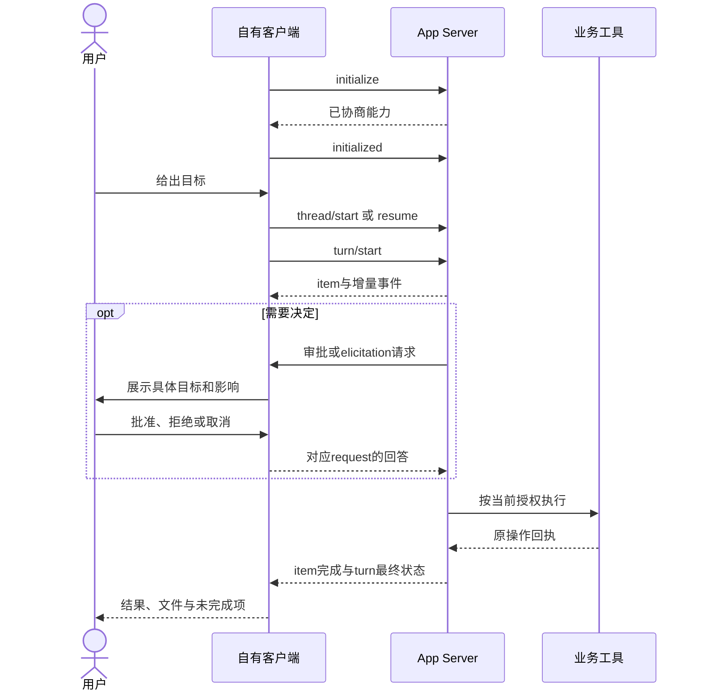

# CLI、SDK 与运行时

将产品能力交给Codex，与把Codex嵌入产品是两个方向。前者主要用产品CLI、Skills和MCP，后者使用Codex SDK或App Server。运行时还包括Hooks和按支持范围启用的MCP Events，官方来源见[参考资料](../../references.md#codex-sources)。

## 入口与选择

| 接口 | 目的 | 不包含的保证 |
| --- | --- | --- |
| 产品CLI / MCP | Agent操作产品现有能力 | 不自动创建桌面原生UI |
| `codex exec` | 脚本或CI执行一次任务，输出事件/结果 | 进程成功不等于业务或媒体质量通过 |
| Codex SDK | 编程创建、继续与恢复本地线程 | 不等于普通网页可控制用户当前桌面会话 |
| App Server | 自有客户端处理会话、鉴权、审批与流式事件 | 不自动继承桌面浏览器、插件UI或用户授权 |
| Hooks | 在宿主生命周期执行受信处理器 | 不可替代服务端必须执行的授权和审计 |
| MCP Events | 支持宿主的持久事件订阅 | 接收webhook不等于任务完成或所有Codex表面可用 |

## Codex CLI 的完整核心路径

产品方法识别CLI环境后直接操作文件或工具。创建项目按已给目录或公布的OS默认目录继续；TTY缺必要信息时交互输入，非TTY返回稳定缺口与参数提示。可选localhost视图只承担检查、选择、编辑和媒体呈现，关闭它不影响CLI恢复原任务。

不要求CLI用户先打开桌面应用，也不通过虚构的`document.oai`或宿主工具名实现输入框通信。浏览器或MCP App不可用时，输出真实文件引用、摘要和明确恢复入口。

## 非交互模式

```bash
codex --version
codex exec --help
codex exec --json --sandbox read-only "读取本目录文档，列出失效的内部引用，不修改文件"
```

这是会调用Codex模型的示例，不是文档构建命令。采用方在获准的模型、权限和预算下运行。本仓库没有为文档更新执行模型任务。

`--json`使stdout成为JSONL事件流，普通模式把过程信息写stderr、最终消息写stdout。`--output-schema`约束最终结构化回答，`-o`输出最终消息；它们不替代产品执行器的Schema、幂等和修订校验。解析事件不能假设最后一行总是成功文本。

当前官方说明`--full-auto`不再支持。不要为减少交互默认关闭沙箱或批准；仅对当前目标配置需要的权限。记录`thread.started`、turn状态、实际工具结果与输出文件，不以流建立或线程创建当任务完成。

## SDK 的方向

TypeScript包为`@openai/codex-sdk`，Python包为`openai-codex`。采用方固定依赖版本，使用对应类型与运行时；本规范不要求全局安装或自动升级。

```typescript
import { Codex } from "@openai/codex-sdk";

const codex = new Codex();
const thread = codex.startThread();
const result = await thread.run("读取当前目录的文档，检查内部引用，不修改文件。");
console.log(result.finalResponse);
// 按应用的会话存储策略保存 thread.id，后续使用 resumeThread 接续。
```

此示例启动由应用管理的线程，未操作已有桌面输入框。工具、网页、工单等外部内容不能伪装成新的人类授权；在SDK支持来源标记时使用相应的外部消息类型，保留内容的不可信身份。

## App Server 协议

`codex app-server`提供双向请求、通知和服务端发起请求。默认stdio采用JSONL；当前文档称JSON-RPC 2.0风格但线上省略`jsonrpc`字段，不能直接把MCP客户端连上去就视为兼容。

```bash
codex app-server generate-ts --out "./schemas"
codex app-server generate-json-schema --out "./schemas"
```

这些命令生成与本机Codex版本匹配的合同，采用方据此实现客户端。生成不会证明远程版本兼容；合同摘要与客户端制品一起冻结。

| 阶段 | 当前公开方法或事件 | 客户端责任 |
| --- | --- | --- |
| 初始化 | `initialize` → `initialized` | 声明客户端、协商能力与实验开关 |
| 会话 | `thread/start`、`thread/resume` | 保存thread标识、目录与环境，不复用错误账号 |
| 执行 | `turn/start` | 输入、授权、模型和目标范围明确 |
| 观察 | `item/started`、`item/completed`、`turn/completed` | 消费增量、错误和最终状态 |
| 补充/中断 | `turn/steer`、`turn/interrupt` | 区分补充当前turn与新任务，不重复提交业务副作用 |
| 命令/文件审批 | `item/commandExecution/requestApproval`、`item/fileChange/requestApproval` | 显示真实范围并处理批准、拒绝和取消 |
| 权限 | `item/permissions/requestApproval` | 只授予请求的子集，遵守turn/session范围 |
| 用户输入 | `item/tool/requestUserInput` | 绑定thread/turn/request，处理清理和迟到回答 |
| MCP表单 | `mcpServer/elicitation/request` | 区分form、URL及协商的`openai/form` |
| 请求清理 | `serverRequest/resolved` | 清除相应等待UI，不把清理当批准 |



超时、关闭窗口或中断不默认为批准，重连先核对原thread/turn和业务原操作。服务端请求清理后不再提交旧回答。宿主和模型的成功状态不能抹去业务结果中的unknown。

当前WebSocket传输被官方标为实验且不受支持。优先本地受控连接；不能裸露非loopback监听并假定有认证。动态工具等实验字段需显式opt-in，不能作为所有用户的核心依赖。

## Hooks 的能力与代价

本地Codex可从用户、项目、托管配置与启用插件载入hooks。项目来源受信任策略控制；非托管hooks需审核当前定义及脚本内容，更新脚本也可能要求重新审查。

| 事件类型 | 典型用途 | 约束 |
| --- | --- | --- |
| SessionStart / SessionEnd | 有限上下文和资源收尾 | 不进行全项目同步扫描或自动登录 |
| PreToolUse / PostToolUse | 范围检查、结果记录 | 不改变原工具的授权事实 |
| PermissionRequest | 已支持的权限审查协作 | 不把hook存在当用户批准 |
| UserPromptSubmit / Stop / Interrupt | 有界记录、完成检查或取消清理 | 避免递归唤醒、自激和阻塞输入 |
| 模型、压缩与子任务事件 | 宿主支持的诊断和接续 | 使用目标版本Schema，不假定其他载体具有同名事件 |

当前处理器支持`command`与`mcp_tool`；`prompt`和`agent`虽被解析，但会被跳过。MCP hook复用已有连接，不会自行启动或重连服务，也不经过普通工具审批及再次触发hooks。错误、缺服务或超时可能放行，所以必须执行的安全控制放在正式业务服务。

云编排不加载本地插件hooks。特定工作区的云端加本地接入可使用管理员配置的Global MCP hooks，这是单独模式，不是“装了插件就全端生效”。公共目录含hooks的资格限制见[插件](plugins.md)。

每个hook计入首个反馈和任务尾延迟；日志和索引能后台做的按支持能力有界执行。hook不保存完整提示词、密钥或与目标无关的用户内容。

## MCP Events 与后台接续

官方MCP Events指南描述ChatGPT通过webhook订阅事件；当前接口为`events/list`、`events/subscribe`、`events/unsubscribe`。其依据仍为事件扩展草案，不可推导所有Codex宿主支持；轮询、流式及草案的gap/terminated控制通知不属于该集成支持范围。

服务持久化订阅主体、过滤器、回调、密钥和期限。先验证HTTPS回调与签名挑战，连接时阻断私网地址和重定向；再发送已签名、带唯一eventId的事件。重试保留eventId，接收方去重；单请求一事件、完整body不超过256KiB。密钥不进入普通回执或模型上下文。

2xx仅表示收到，不能表示Agent处理完成。事件提供摘要和原对象引用，恢复时回读当前权限与修订；撤权、断连或退订停止交付。定时任务、事件唤醒、业务任务取消与UI关闭分别处理。普通localhost网页不能用发webhook模拟宿主会话唤醒。

事件用于“某对象变更后重新检查”这类已授权后续，不为每个拖拽和临时预览发送通知。防止Agent修改引起事件再修改的无限循环，无事件支持时由原操作查询和显式继续完成任务。
