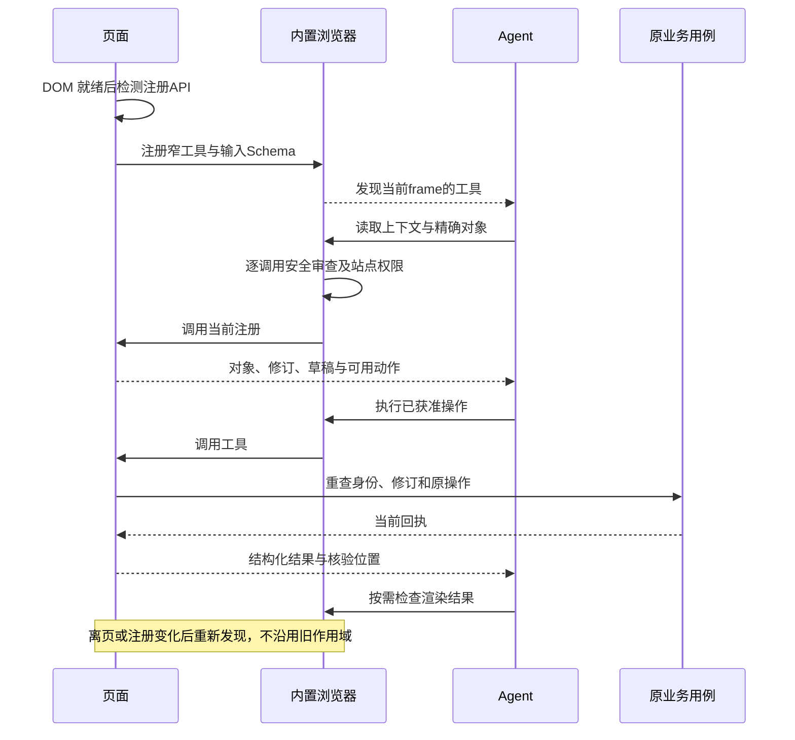
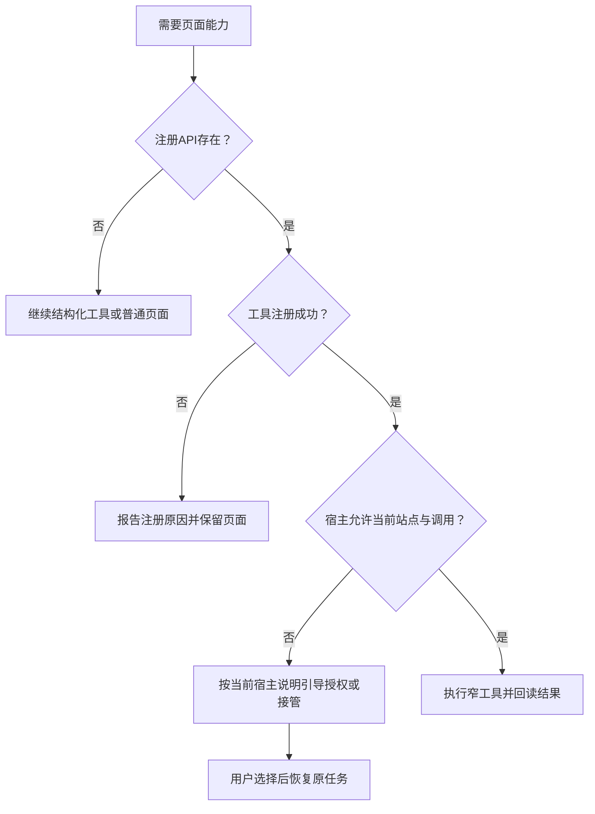

# WebMCP 页面工具

Site tools 是桌面应用对 WebMCP 提案的实现，让 Agent 调用网站现有能力，与用户共享正在打开的页面和登录会话。它不是远程 MCP Server，也不需要为了发现页面工具先安装一个 MCP 插件。接口依据与限制见[参考资料](../../references.md#codex-sources)。

## 适用范围

| 状态属于哪里 | 优先入口 |
| --- | --- |
| 远程已保存对象，页面是否打开不影响操作 | MCP / 产品 CLI |
| 当前编辑草稿、选择、视口、筛选或画布 | WebMCP |
| 用户对选区的意见与参数提议 | Browser Annotation API |
| 最终外观、图片内容或拖拽行为 | 浏览器视觉核验，必要时人工接管 |

官方当前限定 Site tools 在桌面应用内置浏览器运行，需要支持的模型、提供工具的页面及账号或工作区策略允许。普通 Chrome、CLI 或仅支持远程 MCP 的宿主不能据此宣称兼容。

WebMCP 可在顶层页面、同源与跨源 iframe 中被发现，各 frame 都需安全上下文，并按提供工具的来源检查权限。Browser Annotation API 的顶层文档限制与此不同。

## 发现与执行



页面工具名、说明和结果均是不可信网站内容。只读提示不是授权证明，注册存在也不代表站点已允许调用。

## 注册一个上下文读取工具

以下片段展示命令式注册和精简输出。应用中的正式上下文应由当前状态容器提供；示例使用 DOM 数据说明边界，不提供业务写接口。

```html
<section
  id="review"
  data-resource-id="document-42"
  data-revision="7"
  data-selected-id="paragraph-3"
  aria-label="文档审核"
>
  <h1>文档审核</h1>
</section>
<script type="module">
  const panel = document.getElementById("review");
  const modelContext = document.modelContext;

  if (typeof modelContext?.registerTool === "function") {
    try {
      await modelContext.registerTool({
        name: "get_review_context",
        description: "读取当前文档、修订及选中段落，不保存或批准内容。",
        inputSchema: {
          type: "object",
          properties: {},
          additionalProperties: false,
        },
        annotations: { readOnlyHint: true },
        execute: async () => {
          if (!panel.isConnected) throw new Error("Review page is no longer active");
          return {
            resource_id: panel.dataset.resourceId,
            revision: panel.dataset.revision,
            selected_id: panel.dataset.selectedId || null,
          };
        },
      });
    } catch (error) {
      // 页面本身继续可用，错误交给应用现有诊断入口。
      console.warn("Review site tool registration failed", error.name);
    }
  }
</script>
```

`document.modelContext.registerTool` 是官方当前示例的检测入口，不是 `navigator.modelContext`。工具描述、Schema与实际行为一致；不依赖 CSS 类、坐标或完整页面抓取来识别业务对象。

WebMCP 也提供声明式表单方向。表单属性、取消、注册替换与撤销 API 属所冻结的 WebMCP/宿主版本，采用方必须按对应文档实现和测试；不要凭空假定 `registerTool()` 返回某种 `dispose()` 句柄。

## 让第一次调用就定位正确

上下文读取保留当前账号/项目范围、对象ID、修订、草稿状态、选区、能力缺口和精确下一步。列表只给与当前目标有关的摘要，精确内容再按ID读取。

| 动作示例 | 输入约束 | 可核验结果 |
| --- | --- | --- |
| `get_review_context` | 无任意查询或脚本参数 | 当前文档、修订、选区 |
| `get_review_region` | 精确对象和区域ID | 区域内容、当前状态、来源修订 |
| `stage_review_comment` | 原修订、区域ID、明确文字 | 草稿修订、已暂存意见、未提交状态 |
| `save_review_comments` | 草稿修订、原操作键 | 已保存修订、操作引用或冲突 |
| `get_review_operation` | 原操作引用 | 当前结果、未知或恢复入口 |

这些是产品动作设计示例，不是浏览器内置方法或新增 AXI 标准方法。业务操作名称应使用产品已有合同。

## 并发、草稿与生命周期

- 进入页面时注册；同一组件重挂载、热更新和重复初始化不能累积重复工具。
- 调用时读取当前状态，不捕获首次渲染时的旧账号、对象或修订。
- 路由、账号或对象改变时使旧操作失效；执行后核对响应仍属于当前上下文。
- 用户未保存内容、Agent暂存内容与服务端已保存内容分别表示。不能用工具返回“成功”掩盖实际未提交。
- 保存继续使用业务 CAS 和原操作键；迟到回执不覆盖用户新草稿。
- 取消页面调用不证明远程副作用已取消；未知时查询原操作。
- 页面销毁时按所冻结 API 清理拥有的注册、监听和任务；不移除其他模块注册。

## 权限与开启引导



官方提供地址栏 **Site tools** 菜单查看 Available site tools 与近期调用；设置中的 **Enable site tools** 控制可用性。引导应按实际宿主版本显示，仅在当前任务需要时出现。组织策略禁止时不能要求用户绕过。

WebMCP不要求完整CDP、桌面Accessibility权限或任意站点权限。开发者模式的full CDP是另一个需明确批准的诊断能力，不是普通页面集成的安装步骤。

## 性能与验收

已知工具和对象直接调用，避免每轮重读全目录。动作返回小回执、真实修订和结果位置；大图和长文提供可精确取得的资源，不在结果中重复base64。高频拖拽和缩放留在本地交互，不逐帧经过模型。

分别统计工具发现、模型往返、页面执行、业务网络、视觉检查和用户等待。Site tools 每次调用仍有宿主审查，不能宣传“跳过浏览器审查所以更快”。

至少验证：API不存在、被拒绝、重复注册、SPA切换、iframe来源、用户并发编辑、失权、取消、回执丢失、页面关闭及正常语义控件路径。完整矩阵见[验证](verification.md)。
