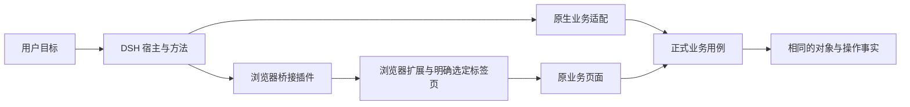

# DSH 与浏览器桥接

本页中的 DSH 指 DeepSeek Harness；浏览器机制参考固定提交的 `omdsh-dev/dsh-browser`。它不是 Codex 插件的别名，也不能仅因提供工具就推断实现 MCP Apps。

## 两种接入

| 路径 | 角色 | AXI 需要保留 |
| --- | --- | --- |
| DSH 原生工具/插件 | 把业务能力暴露给 Harness | 输入、范围、身份、状态和原操作恢复 |
| 浏览器桥接 | 连接用户正在使用的标签页 | 当前标签身份、页面范围、语义定位和必要视觉核验 |

不需要页面状态的步骤优先用正式业务能力。需要保留页面编辑、既有会话或视觉操作时，桥接可以作为执行载体；页面登录不等于另一工具连接也自动具有身份。

## 可借鉴的交互机制

固定来源提供文本快照、编号控件、局部/差量读取、选定标签页、动作附结果和有界就绪等待。这些机制减少重复观察和模型往返，但不能把其特定基准推广成所有宿主的速度承诺。

稳定编号只在其有效页面范围内可用，导航、标签切换、对话框或对象变化后重新观察。敏感字段遮罩不代表截图也已经遮罩；视觉采集权限单独处理。

## 安装与更新边界

该参考实现由桥接插件与浏览器扩展组成，单个通用插件安装命令不足以完成全部接入。采用方需核对两端版本、构建、注册、扩展加载、握手、标签绑定和撤销；不能只升级其中一端后宣称可用。

本规范不执行参考项目的远程安装脚本，不将其运行时版本和本地端口定为 AXI 要求。具体版本和命令属于采用方冻结的安装合同。

## 鉴权与卸载

桥接身份保护本地/远程连接，业务身份保护网页或服务数据，两者分开。浏览器 Cookie 不应导出给 CLI 或 MCP；工具只使用获准的桥接会话。

禁用桥接时停止新动作，核对已派发操作，清除短期标签和控件引用；卸载扩展不等于撤销业务服务授权。真实兼容性需在 DSH 与浏览器组合中验证，本仓库当前仅提供适配指南。
