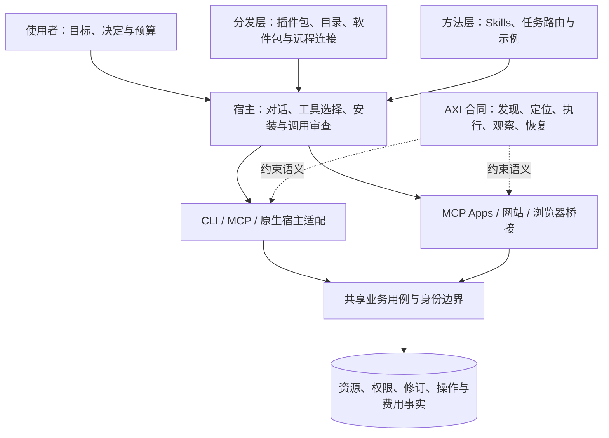

# 协作模型

AXI 与 CLI、MCP、Skills、插件和交互视图一起构成面向 Agent 的产品入口。各层共享业务语义，但分别解决不同问题；采用 AXI 不要求替换已经有效的协议或分发机制。

## 分层职责

| 层 | 主要责任 | 不能替代 |
| --- | --- | --- |
| 业务合同 | 范围、权限、修订、副作用和事实 | 宿主安装或工具发现 |
| AXI | 跨入口一致的任务语义与验收 | 传输、OAuth、包管理和 UI 沙箱 |
| CLI / MCP / 原生适配 | 用既有载体暴露动作 | 业务最终授权 |
| Skills | 何时、如何组合能力及输出结果 | 动态 Schema、实时状态与凭据 |
| 插件 / 软件包 / 连接目录 | 组合、发现、安装和更新组件 | 用户已连接或任务已成功 |
| MCP Apps / 网站 | 人的检查、选择、编辑与接管 | 无界后台执行和隐式新增授权 |
| 宿主 | 能力选择、上下文、审查、呈现和连接管理 | 业务服务的最终事实 |

## 两类 UI 与三条路径

Agent 的 UI 可以是命名空间、用途索引、Schema、回执和恢复入口；人的 UI 可以是网页、终端或会话内视图。它们应处于相同的产品质量层级，共享对象和权限，但不必相同外观。

1. **直接执行**：已知合同 → CLI/MCP/原生工具 → 业务结果。
2. **交互协作**：工具返回可用结果 → 人在 MCP App 或网页中检查/选择 → 回读同一任务。
3. **页面操作**：需要本地页面状态 → 页面工具或语义控件 → 原业务用例。

Skill 可以指导三条路径；不需要视觉的任务不应被强制拉进浏览器。MCP App 不可用时，应根据任务保留结构化结果、网页接管或明确的未完成项。

## 从安装到退役

每种载体都要回答：从哪里获得可信制品、怎么启用、如何连接身份、怎样发现和执行能力、如何升级而不破坏在途任务，以及如何撤销权限和卸载。完整流程见[生命周期](../lifecycle/index.md)。

新载体通过[适配合同](adapters.md)加入；无需修改领域事实或复制业务规则。当前文档对接范围和实际实现状态见[兼容性矩阵](compatibility.md)。

## 宿主适配

每个宿主维护独立目录，分别记录公开接口、分发、身份、交互、运行时和验证范围。共同语义仍以核心规范为准，不把某个宿主接口推广为跨平台要求。

| 宿主 | 本仓库文档范围 |
| --- | --- |
| [Codex](codex/index.md) | 插件、Skills、MCP、WebMCP、标注、MCP Apps、原生扩展、文件/消息、CLI/SDK/App Server、Hooks与事件 |
| [Claude Code](claude-code/index.md) | 原生插件、方法、MCP、Hooks和Mods的初步调研与差距 |
| [WorkBuddy](workbuddy/index.md) | Skills、连接器、渐进连接和浏览器Skill的初步调研与差距 |
| [DSH](dsh/index.md) | 固定来源的原生插件与浏览器双组件机制 |
