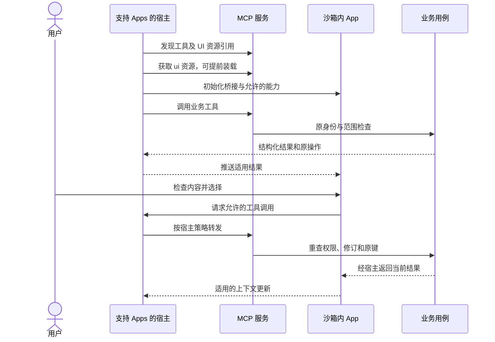

# MCP Apps

MCP Apps 把交互式 HTML 界面嵌入支持它的 MCP 宿主，用于检查、比较、编辑和选择。AXI 将它视为与 Agent 工具合同协作的人类界面载体，保留同一任务与事实源。

## 核心组成

根据 MCP Apps 官方文档，工具描述可通过 `_meta.ui.resourceUri` 引用 `ui://` 资源；宿主获取 HTML，并在受控环境中渲染。App 与宿主通过基于 `postMessage` 的协议交互，宿主代理允许的工具调用。

本图表示职责，不增加新的 AXI UI 消息；具体方法、版本和资源元数据由所选 MCP Apps 规范决定。

## 适用任务

文档或图片预览、图表探索、多参数选择、逐项审核和长任务观察适合交互视图。工具本身应返回可用于核心步骤的结构化结果，避免没有 UI 的宿主完全无法继续。

App 的本地选择不自动等于领域写入。用户点击保存或批准后，通过同一正式工具写入；模型应回读原任务，不假定视图一关闭就已成功。页面保存与会话唤醒分别处理。

## 沙箱与授权

宿主控制 iframe 沙箱、工具代理和能力。资源 `_meta.ui` 可声明 `csp` 和 `permissions`，但声明不表示已经获得摄像头、麦克风、外链或其他权限。限制外部资源来源，不把凭据注入 HTML、URL、模型上下文或普通工具结果。

App 不依赖读取父页面 DOM、宿主 Cookie 或任意 localStorage 作为身份桥接。业务服务仍验证实际工具调用的身份和范围；视图中的“允许”只是投影。

## 初始化、更新与失效

初始化前保持稳定装载状态；收到结果时核对任务、对象和修订。切换身份或资源时清理旧数据，丢弃迟到更新。视图关闭只停止本地观察，不自动取消业务操作。

UI 资源应有可核对版本或摘要，避免旧 HTML 使用新工具的破坏性输入。宿主缓存、工具 Schema 和服务升级的关系需要在[升级流程](../lifecycle/update.md)中一起验证。

## 无 Apps 支持时

依据宿主能力使用结构化结果、资源链接或网页接管。必须视觉核验的部分明确保留；不能因为文本返回成功就宣称图像质量通过。MCP Apps 与 OpenAI 专有 UI 扩展可能存在共同能力和差异，不把其中一个桥接 API 当成全部宿主标准。

本仓库提供设计与文档验证，未提供运行中的 App。实现需另测初始化、结果推送、工具代理、取消、CSP、失权和目标宿主任务，见[兼容性矩阵](compatibility.md)。
