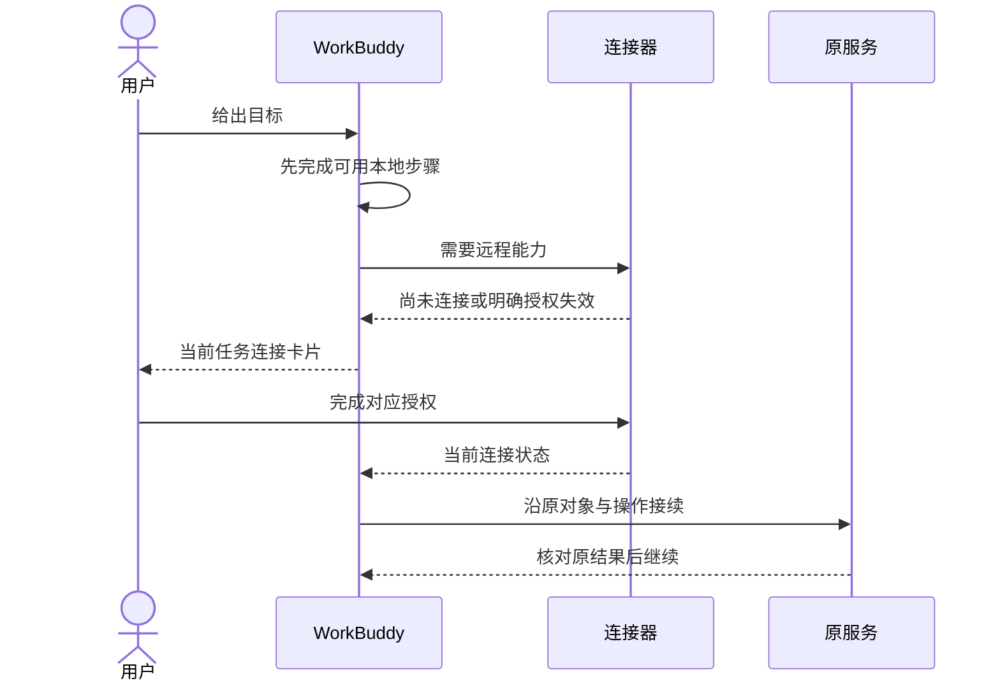

# WorkBuddy 适配

本目录独立记录WorkBuddy接口与交互。2026-11-09已读取官方Skills、连接器、Agent Browser与上手指南，来源见[参考资料](../../references.md#other-host-sources)。WorkBuddy与CodeBuddy的IDE、插件及CLI是不同产品面，不合并支持声明。

## 已确认的接入面

| 能力 | 已核实行为 | AXI采用 |
| --- | --- | --- |
| Skills | 市场安装、包上传、创建、启用与卸载 | 保留方法元数据、版本、来源及脚本权限 |
| 自定义连接器 | 可配置自定义MCP服务 | 使用当前服务合同和获权身份 |
| 连接器实现 | 官方区分MCP + CLI与Skill + CLI | 不从“连接器”名称猜测transport或运行位置 |
| 按需连接 | 任务中展示引导，授权后继续原任务 | 首个本地结果前不要求无关登录 |
| 重新连接 | 明确授权失效时提示，网络/服务错误不被误判为登录失效 | 缺权限、网络、过期和unknown分开处理 |
| Agent Browser | 官方推荐的浏览器Skill可打开、滚动、点击、截图及读取 | 需要交互才用浏览器，核心业务仍优先直接工具 |

官方Skills页面说明，关闭Skill后，已加载的当前会话仍可能使用，新会话才完全生效；开关不改SKILL.md文件。采用方验证实际加载状态，不能用配置开关图标证明当前运行已经替换。

## 渐进鉴权

官方描述重新连接后对失败步骤自动重试一次。AXI采用方仍需保留原操作键：若前次结果未知，先查询，不把重新登录当重复发送付款、生成或消息的理由。

## 权限与持久化

Skill可能执行脚本、读写文件或把输入发往第三方。安装来源、执行环境、获权目录、模型网络与业务连接分别记录；“本地任务”不能自动证明模型上下文不出设备。

连接器启用、断开连接、上游撤权与卸载是不同操作。无连接时保留原项目和草稿，不导出浏览器Cookie来伪装CLI身份。Skill安装和连接成功都不能代替业务最终授权。

## 证据边界

当前仅核对文档，未验证精确宿主版本、连接器schema、原生扩展SDK、WebMCP、MCP Apps或标注API。官方Agent Browser技能介绍不证明它暴露了Codex同名网页API。涉及这些能力时，按[适配合同](../adapters.md)实测或明确保留接管。
