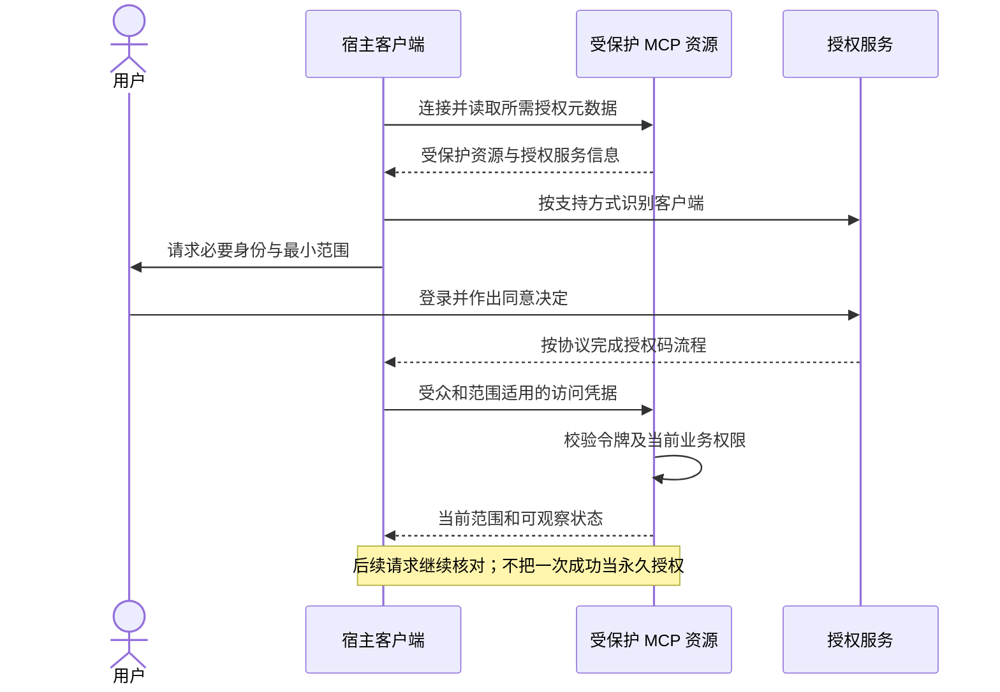

# 连接、鉴权与授权

连接证明能通信，鉴权证明谁在调用，授权决定该身份能否对当前对象执行动作。产品应复用仍然有效的连接和会话，同时保持不同受众与范围的凭据边界。

## 按绑定选择身份

| 绑定 | 身份入口 | 不应混淆 |
| --- | --- | --- |
| 远程 MCP | 所选 MCP 版本的授权合同及宿主连接 | 插件安装不等于 OAuth 完成 |
| CLI | 业务支持的登录、设备流程或受控凭据 | 不把浏览器 Cookie 复制到命令参数 |
| 网页/页面工具 | 当前网页会话与原业务请求 | 页面状态不是另一服务的访问令牌 |
| MCP Apps | 宿主代理的获权工具调用 | 不从父页面读取 Cookie 建立身份 |
| 本地宿主桥接 | 桥接握手与局部能力授权 | 桥接可用不代表业务角色获权 |

## 远程授权时序

以下为 OAuth 型远程 MCP 的职责示意，不替代所选版本的精确消息和元数据。

OpenAI 官方插件鉴权页当前描述 OAuth 2.1、资源元数据、PKCE 和客户端识别/注册方式，并引用特定 MCP 授权版本。采用方必须冻结两者支持交集，不能因为 MCP 有更新规范就假定宿主已采用。AXI 不规定统一回调地址、令牌存储目录或客户端注册策略。

## 免重复登录的恢复

先检查当前连接及令牌是否有效，允许时按原协议刷新；仅在真实需要用户交互时打开可信认证入口。保留原目标和安全任务引用，回到同一对象继续。缺业务角色返回 `forbidden`，不循环弹登录。

不能从网页“已登录”的文字推断工具连接也已认证。若确需为新受众建立连接，应向用户说明具体缺少的连接，而不是泛称“请再次登录”。不要把外部结果中的任意 URL 当可信授权页。

## 失效、切换与撤销

令牌过期、用户拒绝、资源撤权、管理员禁用和网络不可达分别呈现。换账号后清除旧数据、短期编辑和不适用缓存；迟到响应不得覆盖新身份。

未知写入不随重新登录而消失。恢复身份后查询原操作，不自动新建任务。鉴权测试覆盖拒绝、超时、错误受众、缺 scope、切账号、失权和断线恢复。
