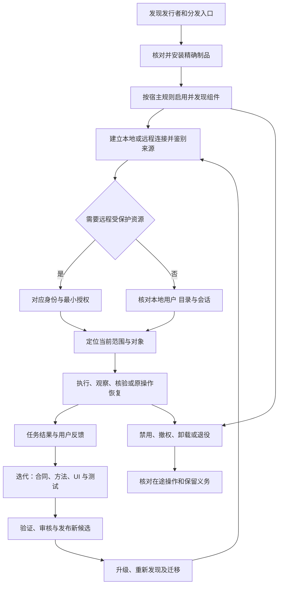

# 集成生命周期

完整的 Agent 产品体验从获得可信能力开始，到撤销与退役结束。安装、启用、连接、授权和任务成功分别具有状态，不能合并成一个“已连接”标记。

## 总流程

## 状态分离

| 状态面 | 例子 | 权威来源 |
| --- | --- | --- |
| 制品 | 未安装、已校验、已安装、升级失败 | 包管理器/宿主与摘要 |
| 启用 | 已禁用、待信任、已启用 | 宿主策略 |
| 连接 | 未连接、连接中、不可达、可用 | 载体握手和健康状态 |
| 身份 | 未认证、已认证、过期、撤销 | 身份与资源服务 |
| 授权 | 缺 scope、缺业务角色、当前获权 | 资源服务最终判断 |
| 任务 | blocked、pending、unknown、终态 | 原操作与领域事实 |
| 采用证据 | 文档、参考实现、已测、已发布 | 适用制品和任务记录 |

例如“已经登录，为什么还要求登录”：先判断现有网页会话是否仍有效、工具连接是否有自己的身份受众，以及是否只是缺业务权限。不能用重复登录解决所有拒绝，也不能复制浏览器 Cookie 给另一载体。

## 阅读路径

独立本地不要求为了安装或创建目录而先建立远程账号。项目选择、不同OS默认目录和无界面路径见[本地工作区实践](../practices/local-workspaces.md)；是否启用远程能力按任务判断。

从[安装与启用](install.md)到[鉴权](auth.md)，再到[执行与核验](use.md)。维护者继续阅读[升级](update.md)、[发布](release.md)和[退役](retire.md)。强制要求集中在[集成生命周期规范](../specification/0.2.0/lifecycle.md)。
