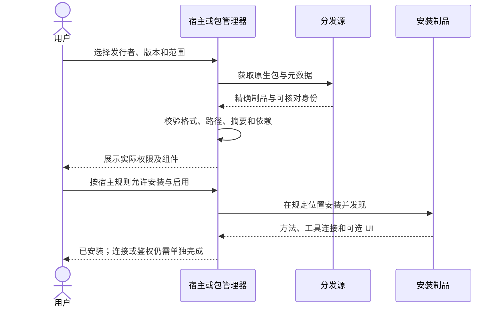

# 发现、安装与启用

安装让宿主获得插件、CLI、方法或连接定义；启用让这些组件在适用范围可见。安装成功不说明远程服务可达，也不表示用户已经授权。

## 发行者交付

提供稳定产品标识、可信来源、精确版本/摘要、支持平台、原生安装入口、依赖、所需权限和卸载说明。本地可执行组件另声明启动、停止和健康检查；纯 Skill 不应附带无关常驻进程。

| 载体 | 获取与启用 | 单独核对 |
| --- | --- | --- |
| CLI | 包或签名二进制，版本与帮助命令 | PATH、平台、依赖和实际执行文件 |
| 插件 | 原生目录或 marketplace 的精确制品 | 包身份、宿主启用范围、方法和连接发现 |
| 远程 MCP | 可信服务地址和原生连接配置 | 服务来源、协议支持和身份 |
| MCP App | 所连服务发布 UI 资源 | 宿主扩展能力、资源版本和沙箱 |
| DSH 桥接 | 宿主插件及浏览器扩展 | 双端版本、握手和标签绑定 |
| 独立 Skill | 方法目录或原生方法包 | 元数据、引用、资源和适用工具 |

## 安装流程

## 失败恢复

依赖缺失、来源不可达、摘要不匹配、无启用权限和组件未发现要分别报告。失败时保留原可用制品，不靠删除用户配置或清空缓存碰运气。重新执行安装前明确是否只是刷新目录、更新包还是重新建立连接。

不要直接执行来源不明的远程脚本来缩短引导。需要本地动作时，先给出来源、具体影响和可回退步骤；安装命令与升级命令依据载体冻结的版本维护。

## 验收

声明离线运行时，安装期下载和运行期网络依赖分别列出；方法索引、UI资源、字体、模板及必要工具应能从声明的制品获得。安装后断网验收具体任务，不以页面缓存或本地stdio启动代替。人类TTY和机器模式、目录选择与OS默认根分别核验，见[本地工作区](../practices/local-workspaces.md)。

在干净隔离环境安装，核对实际文件/包版本与新会话发现，读取离线帮助，再做受控连接。浏览器扩展、App 资源及原生方法分别验收。完成后进入[连接与鉴权](auth.md)。
