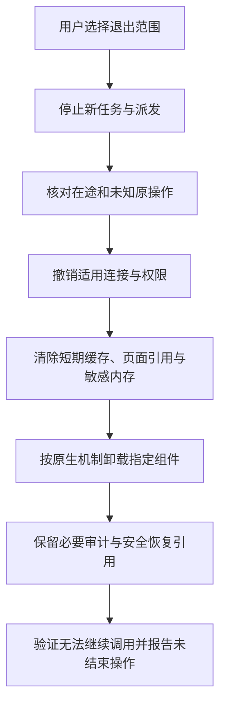

# 撤销、卸载与退役

停用一项集成不自动撤回它已经产生的效果，也不一定撤销远程授权。退出流程必须说明停止的范围、仍在进行的操作和保留的数据。

## 区分动作

| 动作 | 直接效果 | 需要另行处理 |
| --- | --- | --- |
| 禁用 | 当前宿主不再主动使用组件 | 文件、连接与远程操作可能仍在 |
| 断开 | 停止该工具或浏览器桥接连接 | 远程令牌和业务操作 |
| 撤权 | 资源服务拒绝后续访问 | 已提交效果、恢复与人工审计 |
| 卸载 | 按原生机制移除本地组件 | 业务数据、服务授权与计费 |
| 业务取消 | 请求停止指定原操作 | 已完成效果与费用结算 |
| 产品退役 | 结束支持和分发 | 兼容期、恢复保留与数据义务 |

## 退出流程

卸载不应直接删除用户业务数据或生成产物。清理超出本地组件的内容需要明确的业务范围与适用授权。

## 退役通知

发行者说明停止安装、停止新调用、旧操作恢复和最终支持的时间关系，提供迁移或人工核对入口。下线旧合同前核对幂等保留期、费用结算和必要审计，不能让长期未知操作失去查询路径。

宿主禁用后是否仍自动刷新包、远程服务是否仍保存令牌，需要按原生机制分别核对。撤销成功应以实际拒绝测试或权威状态确认，不仅看卸载按钮变灰。
