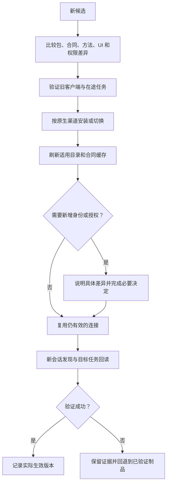

# 迭代、升级与迁移

升级会同时影响工具、方法、UI、缓存、身份与在途任务。包版本变新不意味着旧会话立即重新发现，也不能改变旧操作的固定输入。

## 变化分类

| 变化 | 必须核对 | 不应自动发生 |
| --- | --- | --- |
| 方法措辞或资源变化 | 方法摘要、触发与引用 | 重写全部无关 Skills |
| 工具输入/输出变化 | 合同修订、旧客户端解析 | 静默接受旧参数含义变化 |
| 工具副作用变化 | 新合同、授权与发行说明 | 沿用旧“只读”提示 |
| UI 资源变化 | 资源版本、桥接与工具兼容 | 旧 HTML 直接调用不兼容新工具 |
| 新权限或受众 | 明确连接和新增同意 | 安装更新时扩大授权 |
| 本地运行时/桥接变化 | 依赖、锁文件、双端兼容 | 只升级一端并跳过握手测试 |

## 升级流程

## 在途任务

维护可查的旧操作身份、原输入摘要和合同修订；新客户端查询旧操作时保留原结果语义。服务停止支持旧执行合同前，先保证恢复路径和保留义务，不能靠强制重建任务迁移。

回滚切换制品与适用配置，不撤销已经发生的业务事实；业务补偿是独立获权动作。旧凭据失效和权限迁移按原授权系统执行，不把回滚当恢复旧权限的捷径。

## 兼容窗口

采用方明确旧合同、旧 UI 与旧客户端的支持范围及退出时间。文档更新不自动形成兼容保证；需要不同版本并存时，能力发现明确返回实际可用修订。新规范版本不替载体协议升级，见[版本规范](../specification/0.2.1/versioning.md)。
