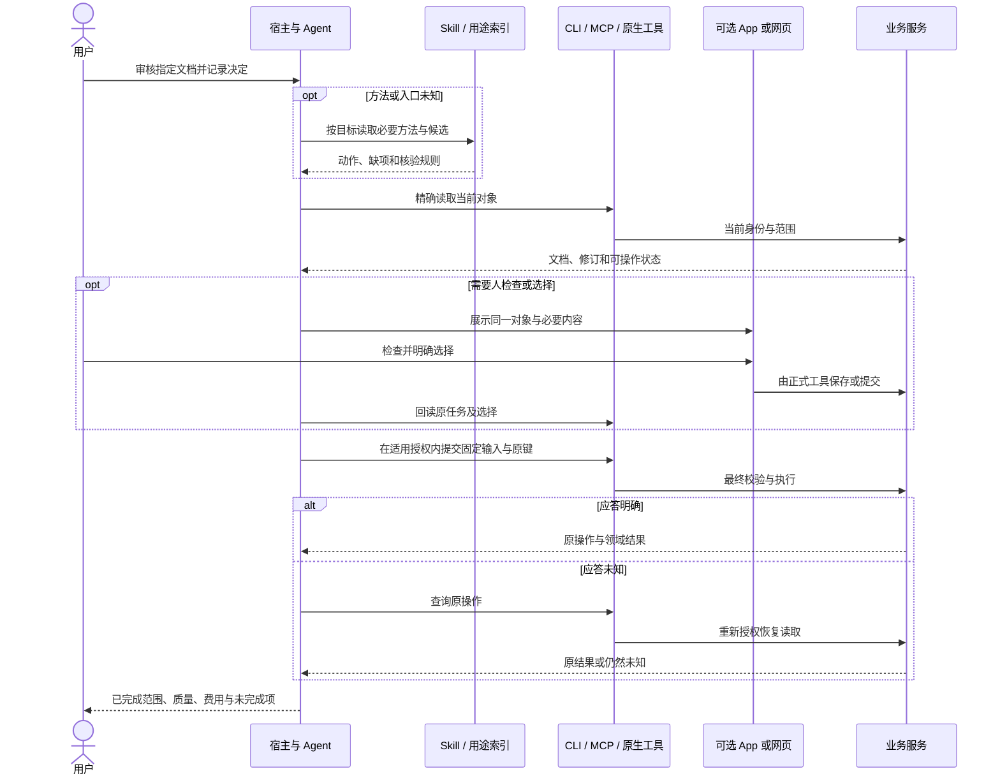

# 发现、执行与核验

使用阶段把安装后的组件组成一次正确任务。Skill 负责路径，合同负责参数，实时上下文负责当前事实，UI 负责必要的人的判断和接管。

## 一次协作任务

图中的 UI 提交和 Agent 提交是可选路径，不应对同一个决定各提交一次。若人已通过 UI 完成，Agent 回读并核验即可；只有尚待执行的已授权动作才继续提交。

## 任务上下文

记录原范围、对象、合同修订、必要资源修订、固定输入和操作引用。支持深链和恢复引用，不能把“当前页面第一个对象”当作任务身份。

只读聚合和等待由确定性代码处理；需要语义判断时交给模型或人。MCP App 的本地选择、网页保存、工具状态更新和会话继续分别验证，避免让用户在“已经选了”后重复选择。

## 结果核验

审批例子只核对决定已记录；媒体任务还需读取实际产物并检查其质量；费用另读权威状态。部分失败保留已成功项，未知保持原操作恢复，不能以完整成功掩盖未测的视觉或外部依赖。

具体要求见[结果](../specification/0.2.0/results.md)和[恢复](../specification/0.2.0/recovery.md)，可运行路径见[快速上手](../start/quickstart.md)。
