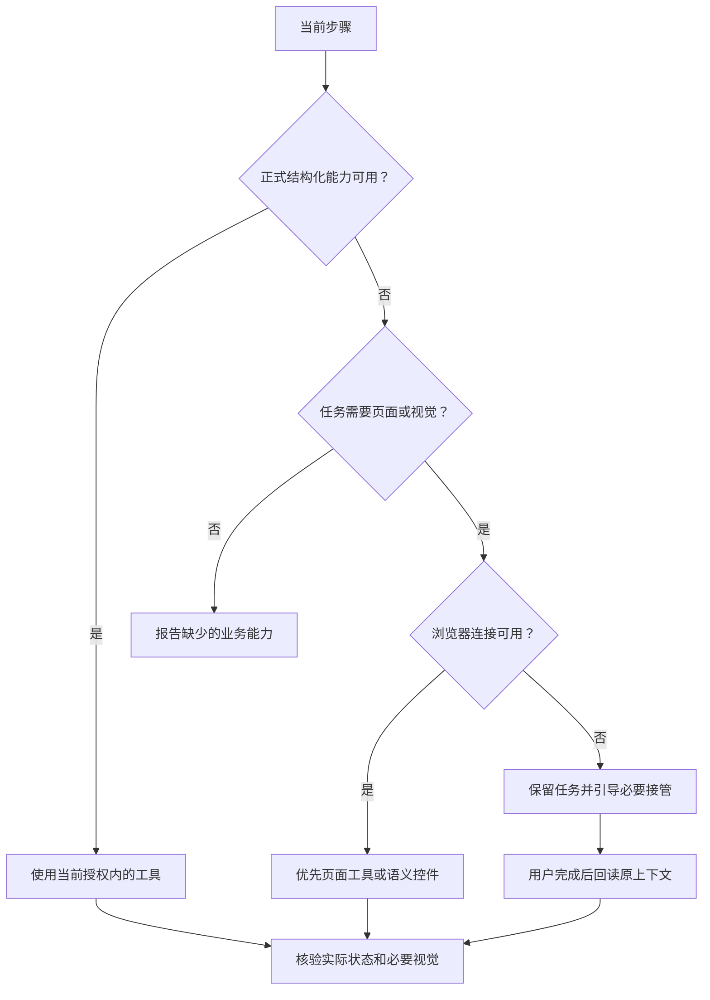

# 无浏览器与人工接管

核心任务应尽可能通过正式工具完成。浏览器是可选执行与核验载体，不能把未开启 Computer Use 的用户一律挡在业务入口外。

## 路径选择

已能通过工具完成的步骤继续做；只有依赖缺失能力的部分等待接管。不能因浏览器不可用而扩展权限、启动任意调试接口或改变原任务对象。

## 精确引导

区分内置浏览器、浏览器扩展、桌面控制、页面级工具和开发者调试权限。只引导当前宿主确有的设置，要求最小必要范围。用户已经开启但连接失败时，按连接故障排查，不重复要求授权。

可用的引导应说明需要完成的视觉步骤、为什么现有工具不足、用户需要在哪里继续，以及怎样返回原任务。具体设置名称随宿主版本核对，不把某个产品菜单写成 AXI 固定要求。

## 接管后回读

用户在网页修改了选择或提交了决定后，客户端重新读取原工作区或原操作，核对对象、修订和实际结果。不要假定一次点击会自动唤醒对话，也不要凭用户说“好了”就宣称后端已成功。

接管期间发生范围切换或撤权时，清除不适用上下文。原操作未知依然保持未知，直到获权回读得到证据。
