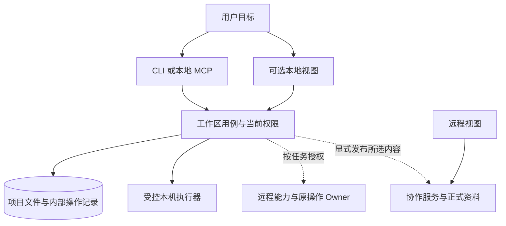
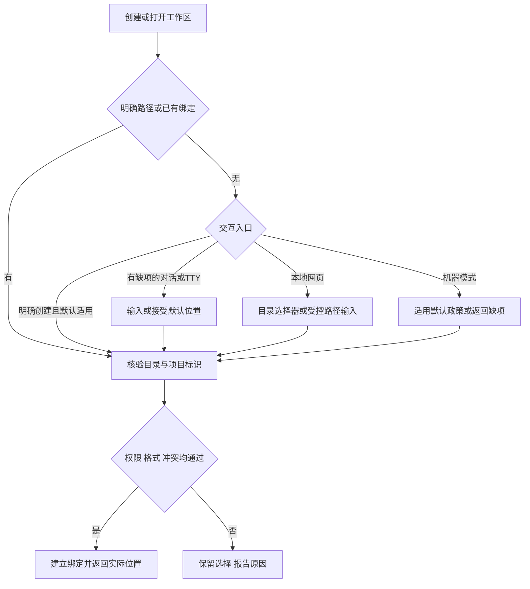
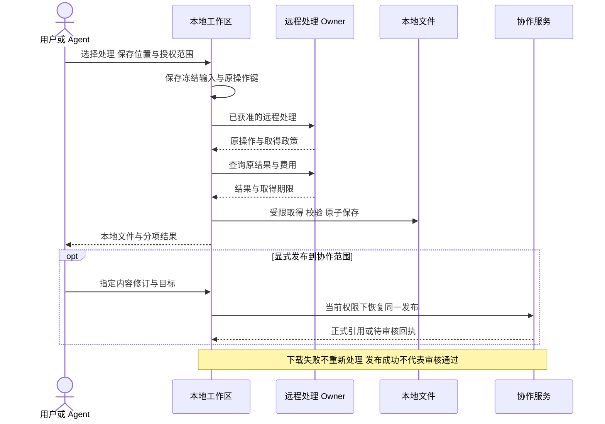

# 本地工作区与云端协作

本页说明如何组合运行模式、项目文件、内部状态和远程能力，不要求每个产品实现离线，也不规定统一项目格式。采用方声明的模式需要具备完整依赖、权限、恢复和任务证据。

## 将四个位置分开

| 维度 | 需要回答的问题 |
| --- | --- |
| 页面位置 | 终端、本地网页、远程网页，还是宿主内的 App？ |
| 内容位置 | 原文件、个人候选、正式资料、缓存和备份分别在哪里？ |
| 执行位置 | 运算发生在本机、用户管理的执行机，还是提供方服务？ |
| 状态归属 | 哪个组件持有编辑修订、原操作、授权、费用和协作决定？ |

远程网页可以操作本地存储；localhost 网页也可能把内容上传。远程模型处理与结果永久入库是不同的数据用途，产品名称或 URL 不能代替声明。

## 三种可组合模式

模式用于声明依赖和路由，不应自动变成首次使用的问卷。明确创建意图可直接使用已公布、可见可改的本地默认位置；已有任务恢复其原Owner。先交付用户目标所需的内容，只有任务触发远程模型、云存储、共享或协作时才展开该阶段的连接和决定。明确要求远程协作的任务可以直接连接，不必先造一个本地项目。

| 模式 | 主要能力 | 必须解释的边界 |
| --- | --- | --- |
| 独立本地 | 本地内容、本机用例、CLI 或可选本地视图 | 依赖预装后可完成哪些断网任务，哪些能力仍需在线 |
| 本地内容与远程能力 | 个人内容保留本地，按任务调用远程服务 | 输入外传、费用、结果取得期限、原操作恢复及保存去向 |
| 远程协作 | 团队资料、共享、审批和跨设备访问 | 服务身份、当前权限、发布边界和正式历史 |

“支持本地 MCP”不等于“支持离线”，本地 MCP 可能只是远程 API 客户端。产品可断网运行也不证明宿主模型推理无需网络，应按任务、依赖和网络条件分别测试。

远程能力可以补充宿主和本机缺少的模型或处理服务，云存储可以独立于远程执行采用。先发现已有可用能力和用户明确要求，不强制重复购买/连接；实际支持、费用、临时取得和永久存储分别说明。云端保存不自动表示团队共享、公开发布或审批通过。

入口共享应用用例，不各建一套资料或操作记录。远程协作权限由协作服务判断，本机目录授权不能冒充远程身份。

## 文件夹与嵌入式数据库

项目文件夹适合让用户和 Agent 直接检查、编辑、备份和交接 Markdown、结构化规格、图片、HTML、音视频及目录。它与服务端的组织、成员和审批模型具有不同边界。

| 内容 | 可采用的存储 | 恢复要求 |
| --- | --- | --- |
| 可编辑源资料 | 普通文本、版本化结构化文件、原媒体 | 每项只有一个可写权威表示，外部编辑后校验并处理冲突 |
| 内部事务状态 | SQLite 等嵌入式事务存储 | 原键、冻结输入、unknown、回执和发布映射持久保留 |
| 生成交付 | 普通文件、相对引用和 manifest | 校验真实字节及依赖，声明源修订和质量范围 |
| 可重建索引 | 数据库派生表或缓存文件 | 可重建不等于可以清空全部数据库 |
| 私密连接 | OS 凭据存储或独立受控配置 | 不进入可分享项目、HTML、URL 或交接包 |

嵌入式数据库应区分权威状态与派生索引。无需把全部任务状态散写成缺少恢复规则的文件，也无需把大媒体和全部用户资料藏进数据库。

文件与数据库不共享原子事务。可采用持久意图、同目录暂存校验、原子改名和完成回执；重启后按文件摘要与原意图核对。多文件修改须公布提交边界和部分完成语义，不能以单文件改名宣称整个目录原子提交。

文件监听只是变化提示，写入前仍核对源摘要/修订。编辑器、Agent 和 CLI 并发时保留用户草稿；移动项目使用相对引用和稳定标识，外部模型等未打包依赖另行声明。打开外部项目不自动信任其脚本、插件或 URL。

SQLite WAL 需要同机共享内存，不能当多机网络文件系统协议。活动数据库须用受支持的一致备份方式取得快照，直接复制主文件可能遗漏 WAL 提交。项目交接还需冻结源文件修订并核对清单，数据库快照不能单独证明媒体一致。

## 创建目录的交互 {#workspace-directory}

支持打开已有项目、指定路径和在获准父目录下新建。已提供有效路径就核验复用；明确创建且默认政策适用时直接采用并显示路径，不为了展示模式选项打断。人类TTY可在同一提示输入项目名和路径，Agent有真实歧义才收集选择，机器模式按合同使用允许的默认或返回具体缺项，不等待不可见提示。

机器模式仅在已公布且当前请求允许默认位置时进入核验，否则返回缺项。用户取消不表示同意默认目录；指定目录不可用不能静默另存。Web 目录 handle、文件上传和本机服务路径不是同一权限，不猜浏览器隐藏的绝对路径。

默认目录遵循 OS 持久文档/用户数据约定；配置、凭据、缓存、临时文件和用户项目分别存放。Windows 用 Known Folder API 处理重定向，macOS 用系统目录解析，Linux 尊重有效 XDG 配置；不能硬编码用户名、盘符或英文文档目录。展示实际路径、来源和更改入口。默认根只用于尚未绑定的新项目，设置变化不自动搬动已有内容。

具体子目录名属于产品合同，OS没有要求所有应用使用同一布局。声明项目内容是否可能进入系统/第三方同步目录；本地保存不承诺第三方不同步。活动数据库不用于多机同步写，目录不可用不能静默迁出内部状态。默认根无法解析或不可写时返回具体原因，不能落到安装目录、cache或临时目录。

## 需要决定时使用原生交互

优先宿主已有的原生选择/输入能力，少量清楚选项、推荐默认与自由输入，相关缺项一次收集。宿主Agent问答、MCP客户端已协商的elicitation、TTY与Web表单是不同适配，不假定支持同一API、交互形式或敏感信息边界。没有原生选择时回到对话/TTY/结构化缺项；已经确定的值不再问，不为纯终端强制开网页。

选择请求关联原任务、对象和所需决定；响应到达后重新核验当前权与修订，取消不按默认接受，过期响应不覆盖新任务。路径字符串不等于OS目录授权，选择模型不等于允许收费/上传。凭据和支付等敏感输入继续使用正式安全流程，不在普通选项或对话中收集。实现按实际宿主/协议版本验证能力、拒绝及恢复，不能从MCP兼容推断原生弹窗已支持。

## 本地服务生命周期与安全

本地网页不是终端任务的前置。需要视图时才启动或复用匹配工作区/版本的服务，返回实际端口；CLI 和本地 MCP 可直接使用用例。长任务明确运行者、持久状态、取消和重启恢复。

仅监听批准的 loopback 地址，检查 Host、精确 Origin、会话与 CSRF，防止恶意网页把服务当文件代理。目录授权限制真实路径、符号链接和具体文件，不向网页开放任意 Shell、SQL 或 URL 读取。凭据不出现在 URL、日志和导出。

远程网页到本机 bridge 是独立可选能力，需要用户允许、来源限定、短期会话、文件范围和停止机制。被宿主或浏览器拒绝时不静默改成上传。远程执行机的 localhost 属于执行机，未建立受控连接前不能承诺用户电脑可打开。

## 在线处理与发布

临时输入、远程结果、个人原文件、缓存、正式资料和审计各有保留政策。临时存储有有限期限、容量、恢复及删除语义；用户下载完成或对象到期不单独证明可删。有效引用、unknown、费用和保留义务须核对；既有永久资料不能因本地模式改为临时文件。

## 采用与验收

各模式分别填写[采用清单](../reference/adoption.md)。本仓库仍只提供审批 CLI 参考例，没有新增可运行本地 Web、媒体生产器或本页的完整混合实现。

| 验收任务 | 证据范围 |
| --- | --- |
| 独立本地 | 依赖已准备，阻断非loopback网络、无远程身份，完成声明的任务和重启恢复 |
| CLI 无界面 | 人类TTY、非TTY/机器模式、无浏览器/App、取消与原操作接续 |
| 渐进开始与选择 | 默认可改且不强迫选模式，真实需要才连接；原生选择/拒绝/取消/不支持、无隐式授权、恢复同任务 |
| 目录与文件 | 指定/默认/取消、不可写/非空、外部修改、逃逸、迁移和缺依赖 |
| 混合存储 | 崩溃窗口、并发、索引重建、unknown保留、数据库和文件一致快照 |
| 远程能力 | 授权范围、取得期限、真实字节、中断、无隐式上传/后端替换 |
| 发布与回收 | 固定修订、同键恢复、引用保护、实际删除及费用/恢复证据分离 |

速度测试区分终端执行、本地和远程视图，记录首个可用文件、完整交付、进程启动、工具/网络往返、传输字节及失败。不能用“使用 localhost”或“改用 SQLite”直接推导提速，方法见[性能实践](performance.md)。
