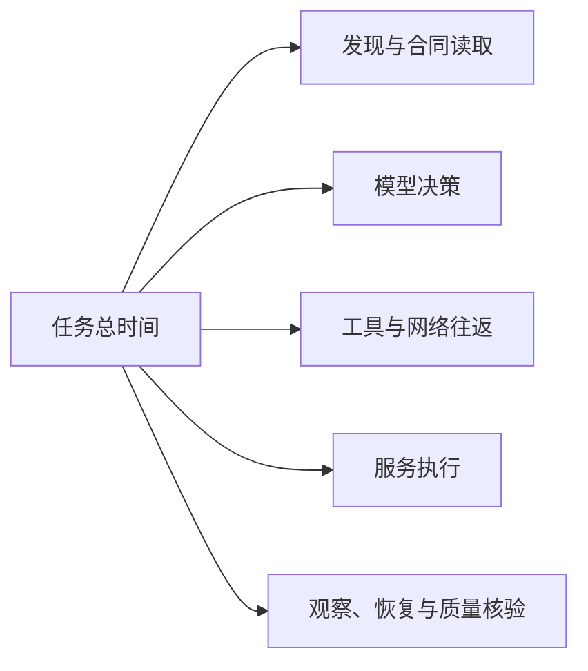

# 减少回合与延迟

优化目标是更早得到正确且可用的结果。工具响应更快、截图更少或 Token 更短都只是中间指标；必须同时核验定位、权限、结果和质量。

## 先定位瓶颈



记录各阶段跨度及关键路径。并行跨度不能直接相加当总耗时；没有服务追踪时，明确哪些时间只能从客户端观测。真实宿主速度与本地协议基准分别报告。

## 按收益实施

| 发现的浪费 | 优化 | 必须保留的边界 |
| --- | --- | --- |
| 已知对象还遍历菜单和列表 | 精确对象读取、深链和任务路由 | 当前获权范围与对象归属 |
| 每轮加载所有合同 | 小索引、候选 Schema 按需读取 | 版本、失效和可发现性 |
| 独立读取逐次经过模型 | 有界并发、只读批量 | 逐项错误、取消和快照说明 |
| 模型反复暂停再问状态 | 服务等待、订阅或修订读取 | 总期限、失权、原操作引用 |
| 同页面重复读取相同对象 | 范围化请求合并、条件读取 | 不缓存授权决定，不吞掉新错误 |
| 页面快照过大、定位不准 | 命名区域、局部状态和控件索引 | 唯一目标与当前对话框范围 |
| 浏览器启动成为关键路径 | 能直接做的步骤用正式工具 | 视觉核验与页面局部状态仍保留 |

请求合并必须考虑身份、范围、查询、修订和取消：一个调用者取消不应无条件中断其他合法订阅者。轮询遇到终态停止，页面不可见时按任务需要暂停；恢复可见时先核对状态，不机械补发所有错过的请求。

## 浏览器动作预算

一次观察已确认一组独立短动作的对象和状态时，可以连续完成它们。跳转、打开对话框、改变对象、提交或遇到异常后重新观察。不要每次无害输入都全屏截图，也不要跨越未观察的页面变化继续盲点。

视觉素材、画布、音视频和最终外观必须保留实际核验。结构化“已生成”无法证明图片是否正确。

## 评测设计

先定义任务成功判据与可接受质量，再选样本。固定制品、宿主、模型、网络条件和数据；冷启动与已有连接分开。比较相同结果下的串行、并行单项和批量，保留失败和原始样本。

```json
{
  "task": "review-fixed-document",
  "variant": "known-contract-direct-read",
  "success": true,
  "first_usable_ms": 1200,
  "completed_ms": 2400,
  "model_turns": 2,
  "tool_calls": 3,
  "http_requests": 3,
  "browser_actions": 0,
  "duplicate_effects": 0,
  "quality": "decision-recorded-content-not-evaluated"
}
```

以上是记录格式示意，数值不是本项目实测。报告样本量、中位数、尾部耗时、失败、恢复与人工介入；样本不足时不制造统计结论。优化验收与任务证据见[验证指南](../verification.md)。
