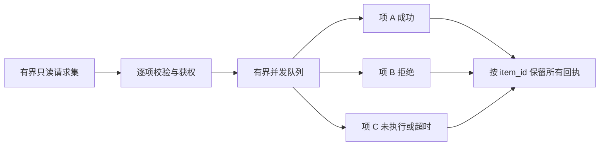

# 批量读取

批量读取把独立的只读工作放入确定性执行器，减少模型回合和网络往返。它是可选能力，不定义跨对象写事务。

## 请求边界

提供方在对应动作的输入 Schema 中声明最大条数、可调用动作白名单及并发范围。客户端使用稳定 `item_id` 关联请求与结果；依赖前项输出的查询不能伪装成独立项。

**AXI-BATCH-001**：批量执行器必须仅接受获准的独立 `read` 动作，逐项执行身份、范围与输入校验，并保留每个输入项的结果；不得通过批量绕过单项权限或用整体成功隐藏失败。

**AXI-BATCH-002**：批量必须有明确条数与并发上限，声明快照语义，返回唯一 `item_id`；取消、超时和部分失败不得丢弃已完成项。未执行项必须可识别，客户端只能按实际失败原因决定是否继续。

## 结果

`batch` 的 `status` 为 `succeeded` 或 `partial`。只有每项都 `succeeded` 时才可使用整体 `succeeded`；混合状态使用 `partial`，所有失败也仍由逐项回执解释，不等于“部分必定成功”。批量只描述封装执行是否完整，业务目标完成度另行核验。

完整样例见[混合批量结果](../../examples/0.2.0/batch.json)。本版批量只支持单一范围；跨范围编排由宿主拆成分别获权的请求。

## 性能限制

批量不必然比已有并行工具更快。应比较串行、并行单项与批量的同等结果，分别统计模型、工具协议、HTTP 与服务耗时，见[性能实践](../../practices/performance.md)。
