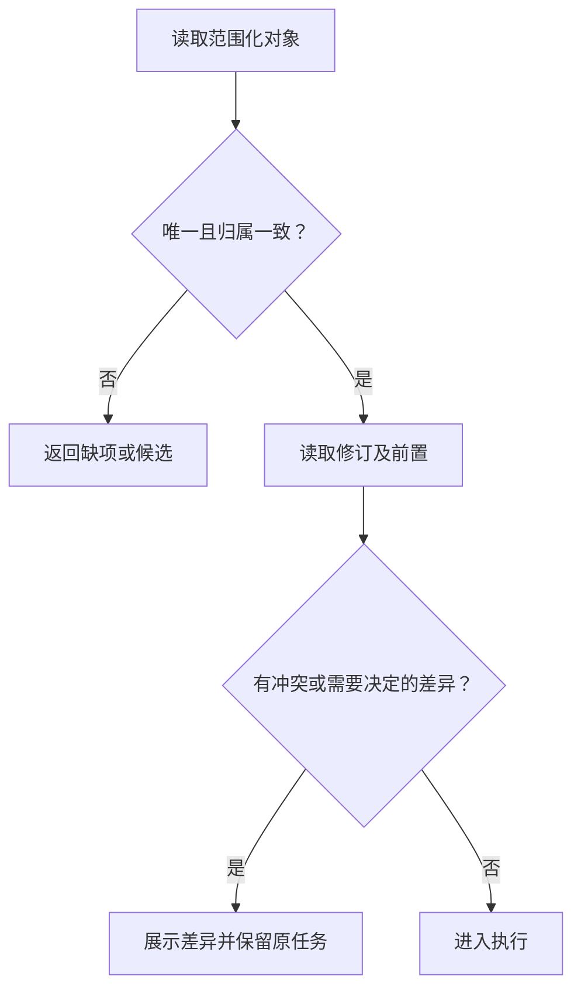

# 上下文与定位

定位解决“这次操作作用于谁、在哪里、哪一版”。资源名称用于检索，资源引用用于执行；不能用列表中的第一项替代消歧。

## 范围化引用

结果的 `context` 至少包含服务端验证的 `scope_id`，可包含 `resource_id` 和 `revision`。多个对象由业务 `data` 表达，不把多个资源标识拼成一个字符串。

**AXI-CTX-001**：调用者必须从用户明确提供的引用、当前获权读取或同一任务的可信返回值中定位对象；多重匹配不得自动选择首项。必要上下文缺失时必须报告缺项，不得退回默认账号或工作区。

**AXI-CTX-002**：服务端必须验证身份与请求范围、对象归属和修订的关系；客户端必须在身份或范围切换时清除旧的敏感内容、临时编辑和不适用的控件引用，并拒绝迟到响应覆盖新范围。

## 同名对象

查询“采购合同”返回两条时，应提供可区分的业务信息，例如所属部门、创建日期与当前状态。若这些信息仍不能确定意图，应请求用户决定。标识可以复制，但不能把截短的哈希当作业务名称。

对象已唯一且合同明确时，不必额外让用户重复确认它的存在。写入时仍要核对当前修订与授权范围。

## 深链与浏览器引用

深链只负责导航；打开后仍要验证当前对象和权限。缺少必需路径参数时不生成指向默认对象的链接。短期控件引用应绑定页面/对话框及当前渲染版本，页面切换后重新定位。

不能仅凭页面标题证明当前项目正确。浏览器至少应暴露对象引用、可访问区域、状态和必要修订，详见[浏览器指南](../../browser.md)。
