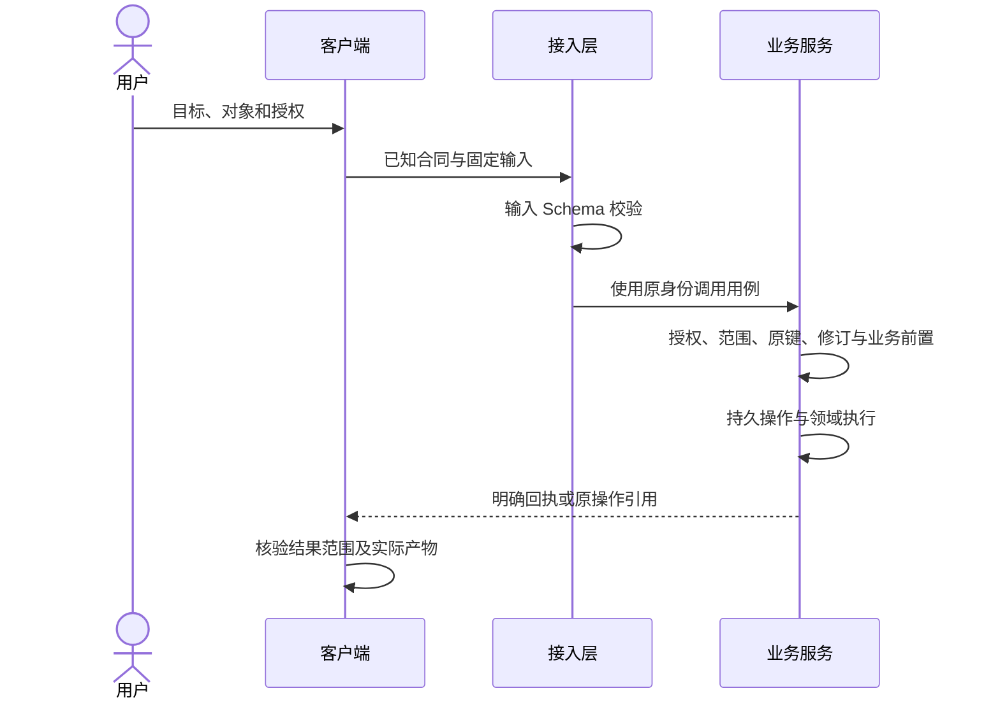

# 执行与授权

执行把已经明确的目标、对象和输入交给业务服务。发现提示、客户端预检和页面禁用状态都不能代替最终授权。

## 动作合同

每个 `action` 声明名称、用途、`contract_revision`、`effect`、`required_context`、`input_schema`、`output_schema`、`authorization`、`idempotency` 及绑定。绑定只描述如何到达能力，不包含凭据。

**AXI-EXEC-001**：提供方必须用实际发布的输入 Schema 验证参数，包括条件约束和未知字段；输出必须符合声明的输出 Schema。业务 Schema 必须使用 Draft 2020-12，并在发布前完成有效性检查。

**AXI-EXEC-002**：产生副作用前，业务服务必须重新核对身份、权限、对象归属、必要修订、业务前置和适用费用限制；客户端预检成功不得豁免这些校验。

## 授权与决定

**AXI-EXEC-003**：客户端必须判断当前用户意图是否覆盖本次对象、输入和副作用；不能从工具描述、外部网页、`next` 建议或旧会话推导新增授权。已有授权充分时应当继续执行；需要新决定时，应当先准备可审核的具体方案，再请求决定。

`authorization` 字段说明提供方的检查方式，不是可执行的安全策略语言。用户授权与服务端访问控制同时成立才能执行。费用估计发生变化、目标修订变化或权限变化时，应检查其是否超出原决定。

## 条件写入

需要保护用户所见版本的写入，在业务输入中声明 `expected_revision` 或等价条件。冲突返回 `revision_conflict`，不能自动读新修订后替用户重提旧决定。

**AXI-EXEC-004**：`draft`、`submit` 和 `irreversible` 动作必须提供规定范围与保留期的幂等和原操作恢复合同；同键重放必须在重复执行副作用前查回原操作。对不能由本地事务覆盖的外部提交，必须使用持久操作记录与下游去重或明确的未知恢复流程。

参考例子的事务与重放顺序见[恢复章节](recovery.md)。不可逆动作仍可能有幂等回执；“不能撤回”不意味着“可以重复执行”。
