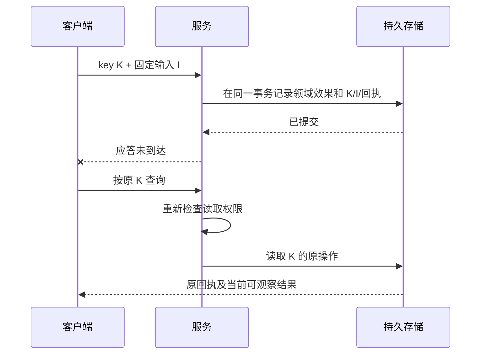

# 恢复与幂等

恢复的目标是确认同一操作的结果，而不是让用户目标再执行一次。请求标识用于追踪网络调用，操作键用于稳定关联领域副作用，两者不能互相替代。

## 固定输入与操作引用

写动作的 `idempotency` 包含 `mode: required`、`key_field`、`recovery_action` 和 `retention_seconds`。键至少按提供方、身份/权限范围和动作隔离。采用方必须说明保留期开始点，以及过期后如何人工核对。

`operation` 包含 `key`、`input_digest`、`recover_action` 和可选 `id`。`input_digest` 是去掉幂等键后、按提供方固定规则规范化的执行输入 SHA-256，表示为 `sha256:` 加 64 位十六进制。跨语言实现必须发布其规范化规则和测试向量；不能假设普通 JSON 序列化在所有语言中一致。

**AXI-REC-001**：提供方必须持久保存原键与固定输入的关联；相同范围、动作和键的相同输入必须返回原操作，异输入必须拒绝。保留期内不得因进程重启、并发请求或客户端重连而重新产生副作用。

**AXI-REC-002**：客户端在提交结果未知时必须保留原对象、输入、键及必要修订，优先调用原操作恢复入口；不得换键、建新任务或自动重复付费。服务端找不到原记录不足以证明外部副作用未发生，除非其合同和事务边界能明确证明未接收。

## 参考实现顺序

1. 校验输入结构并核对当前身份与范围。
2. 在写事务内重新检查权限，按原键读取操作记录。
3. 已存在则比对固定输入，返回原回执或幂等冲突。
4. 首次请求才验证对象修订与业务前置。
5. 原子写入文档决定及操作回执，提交事务。
6. 返回回执；应答丢失时，通过原键恢复。

旧修订的同键重放应先查原回执；先做 CAS 会把成功重放错误地判成修订冲突。恢复读取也要重新授权，不能凭操作键泄露原结果。

## 外部提交与保留期

涉及支付、生成或第三方系统时，本地事务无法覆盖远端副作用。应使用下游幂等键、持久发件箱或可核对的外部操作身份；没有这些保证时如实保持未知，并提供人工核对入口。不能把本地示例事务推广成所有外部写入的恰好一次保证。

**AXI-REC-003**：过期、撤权、取消或范围变化不得解除尚未确认的原操作；恢复不可用时必须报告具体阻塞。过期后重提需要新的事实和适用授权，不能静默清理客户端记录后自动重发。
