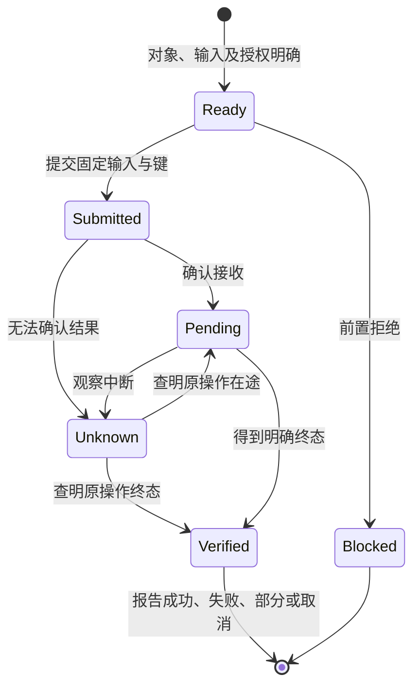

# 结果与状态

结果描述当前证据，而不是客户端希望发生的事情。业务任务终态、产物质量、审核结论与费用状态可以分别变化。

## 状态

| `status` | 语义 | 需要的数据 |
| --- | --- | --- |
| `succeeded` | 本动作承诺的结果已得到确认 | `data`；写入还需原操作引用 |
| `pending` | 已确认接收，尚未达到终态 | `operation`、当前业务状态及观察入口 |
| `blocked` | 本次请求在前置检查阶段被阻止，未执行领域副作用 | `error` 与可执行的解决方向 |
| `failed` | 动作已确认失败；是否已发生部分效果由领域数据说明 | `error`；有已接收操作时保留引用 |
| `partial` | 聚合目标中只有部分达到约定结果 | 成功与失败的逐项 `data` |
| `cancelled` | 本动作取消已被服务端确认 | `data` 说明已发生效果及取消范围 |
| `unknown` | 客户端无法判断原操作结果 | `operation`、`result_unknown` 错误与恢复入口 |

**AXI-RESULT-001**：实现必须按可观察证据选择状态；接收、排队、HTTP 成功或安装完成不得被当作业务目标已完成。`unknown` 不得被改写成可安全重发的 `failed`。

**AXI-RESULT-002**：写入的非 `blocked` 回执必须保留原操作引用；`partial` 必须暴露逐项结论；结果不得把技术成功、质量通过和费用结算合并成未经验证的单一成功标记。

## 最小结果与验证范围

`action` 和 `contract_revision` 指明本次动作合同。`context` 指明已验证范围。`data` 承载领域结果，例如：

```json
{
  "document": {"id": "doc_contract_001", "revision": 8, "review_state": "approved"},
  "verification": {"decision_recorded": true, "content_quality": "not_evaluated"}
}
```

这是结果的业务 `data`，完整回执见[成功示例](../../examples/0.2.0/succeeded.json)。记录了审批决定不代表系统已经重新阅读并确认文档质量。

## 客户端认知状态



该图不定义各领域的生产状态机。恢复可以改变客户端认知，但不得凭空逆转领域事实。终态回执和迟到的在途消息发生竞争时，客户端应按原操作的有效版本处理，不能用旧消息覆盖新终态。
