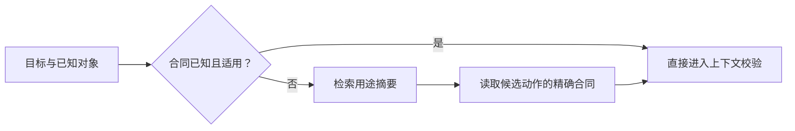

# 能力发现

发现把用户目标映射到候选能力，不执行任务，也不证明当前权限。已知动作和合同修订时，客户端可以直接调用，不必每轮重新列出目录。

## 目录与精确合同

目录条目包含 `name`、`purpose`、`effect`、`required_context`、`contract_revision` 和 `contract_ref`。目录文档另带 `provider_id`、`catalog_revision` 与 `next_cursor`。`contract_ref` 指向动作合同；它不是携带凭据的执行 URL。

**AXI-DISC-001**：提供方必须让目录条目解析到相同名称和修订的动作合同，并保持副作用与必要上下文一致；静态索引不得宣称当前用户已获权。

**AXI-DISC-002**：发现必须允许有界地获得候选；提供方应当支持按用途、名称或领域缩小范围。需要更多条目时，必须提供明确继续路径，不得静默截断成“全部”。



## 示例

```json
{
  "name": "documents.decide",
  "purpose": "为指定修订的文档记录审批决定",
  "effect": "submit",
  "required_context": ["scope_id", "document_id"],
  "contract_revision": "1",
  "contract_ref": "review-action.json"
}
```

这是目录中的一个条目，不是完整 catalog；完整文件见[示例目录](../../examples/0.2.1/catalog.json)。相近工具应说明选择条件，避免多个名字不同的工具都只写“管理文档”。

## 缓存和失效

**AXI-DISC-003**：缓存必须至少区分提供方、规范版本和合同修订；若内容依赖身份范围，还必须按该范围隔离。目录变化、切换身份、撤权或明确失效时，不得继续复用不适用内容。

静态 Schema 与实时对象可以使用不同缓存策略。缓存命中不等于权限仍然有效。MCP 或 HTTP 已提供的更新/条件读取机制应按其本身合同使用，不新增虚构的 AXI 通知协议。

`llms.txt` 是文档路标，Skill 是方法入口，都不能取代精确动作合同。见[Skills 与交付](../../discovery.md)。
